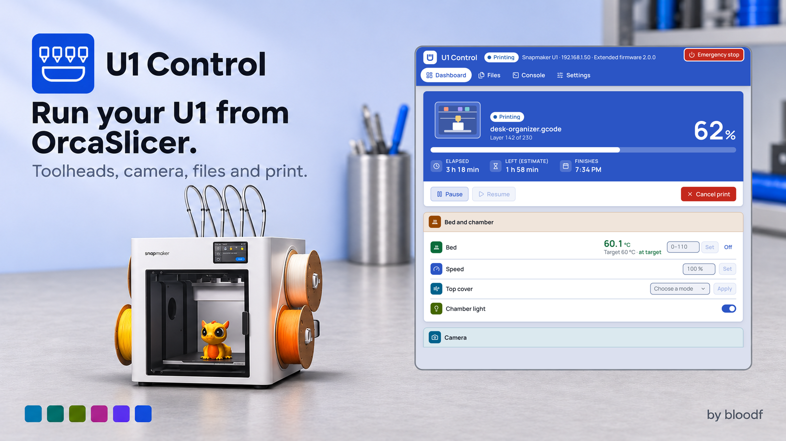
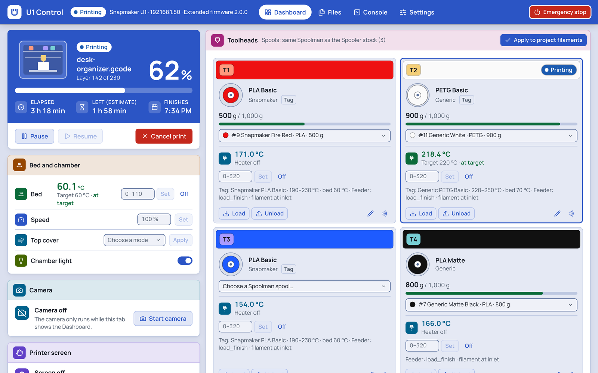
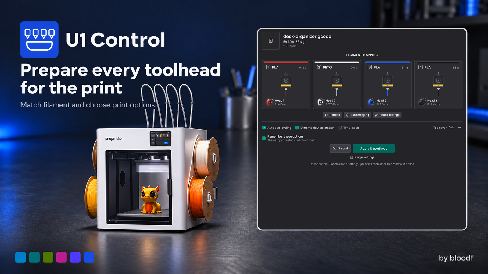
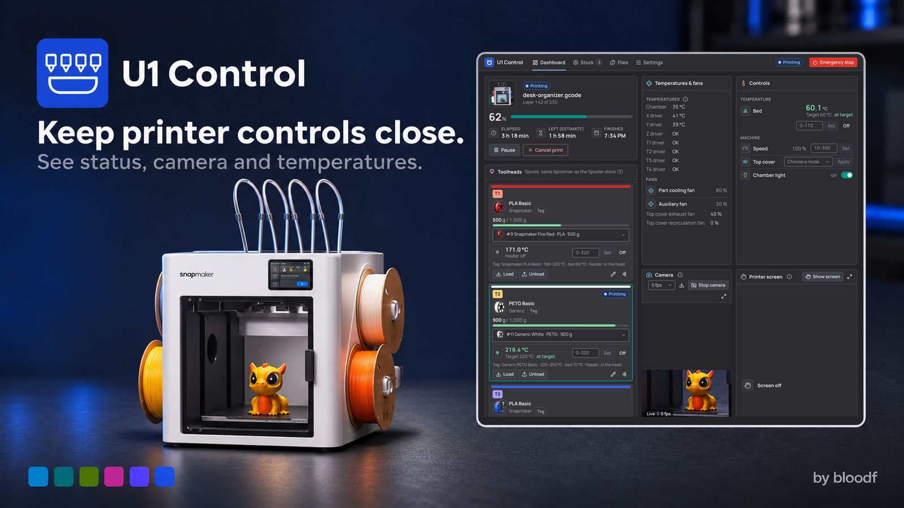
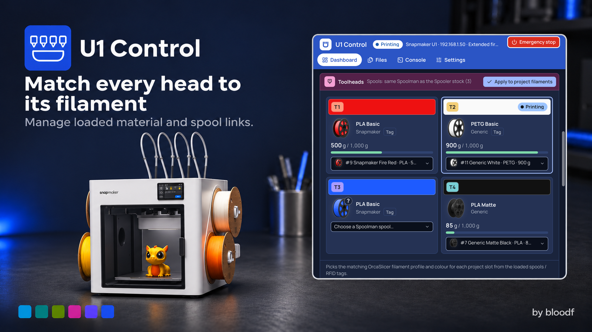
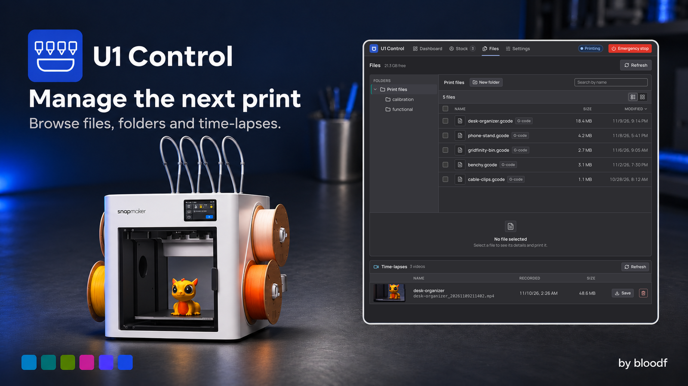
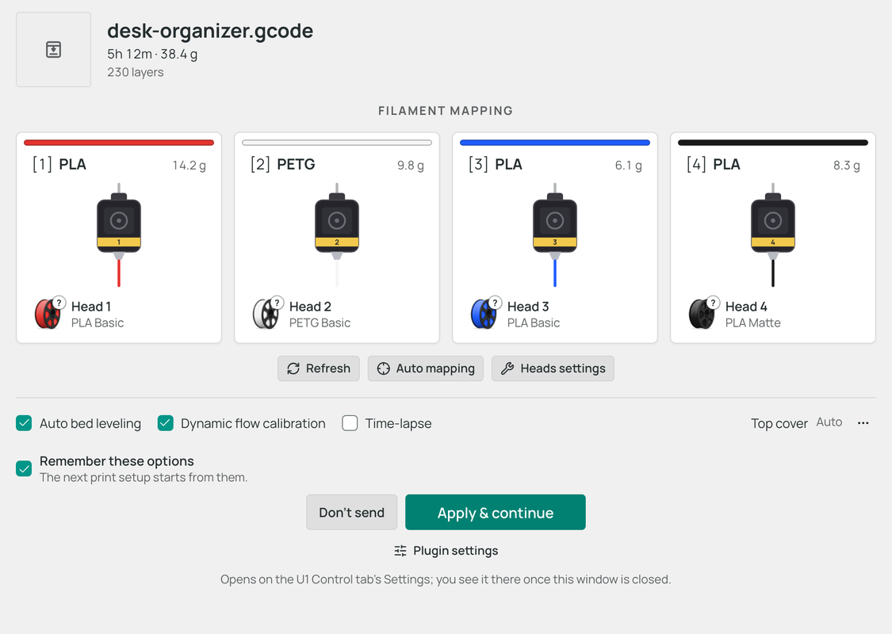

  <picture>
    <source media="(prefers-color-scheme: dark)" srcset="assets/readme/u1control-hero-dark-en.png">
    
  </picture>

<h1 align="center">🔵 U1 Control</h1>

<b>Run the Snapmaker U1 from OrcaSlicer: toolheads, camera, files.</b> An OrcaSlicer plugin · by bloodf

  
  
  
  

  <a href="#-install">Install</a> · <a href="#-features">Features</a> · <a href="#-how-to-use">How to use</a> · <a href="#-faq">FAQ</a> · <a href="README.pt-BR.md">Português</a>

## ✨ What it does

U1 Control is an OrcaSlicer 2.5 plugin for the Snapmaker U1. It adds a printer tab with the camera, the four toolheads, RFID tags, Spoolman spools, a file manager and the firmware settings. When you press **Print**, it matches every filament to a toolhead and fixes the U1 G-code, the way Snapmaker Orca does. It works with the stock Snapmaker firmware and with the [U1 Extended Firmware](https://github.com/paxx12-snapmaker-u1/SnapmakerU1-Extended-Firmware), stays on your local network and needs no extra Python packages.

  <picture>
    <source media="(prefers-color-scheme: dark)" srcset="assets/readme/u1control-screenshot-dashboard-dark-en.png">
    
  </picture>

## 📦 Install

Open [U1 Control on Orca Cloud](https://cloud.orcaslicer.com/p/55b8c347d443) and subscribe, then tick **Activate** under **File > Plugins** in OrcaSlicer.

From a file:

1. Download `u1control_any.whl` from the [latest release](https://github.com/bloodf/u1control/releases/latest).
2. In OrcaSlicer, open **File > Plugins > Install local plugin** and pick the file.
3. Tick **Activate** and allow the background thread when OrcaSlicer asks.

| Requirement | Detail |
|---|---|
| OrcaSlicer | 2.5.0 or newer |
| Printer | Snapmaker U1 on the same network as the computer |
| Firmware | Stock Snapmaker firmware or U1 Extended Firmware |
| Spoolman | Optional |
| Python packages | None |

## 🧰 Features

<table>
  <tr>
    <td width="50%" valign="top">
      
      
<b>Print setup</b> Each filament is matched to a toolhead by material and colour before the file leaves OrcaSlicer.

    </td>
    <td width="50%" valign="top">
      
      
<b>Dashboard</b> Status, temperatures, camera, pause, resume, cancel and emergency stop on one page.

    </td>
  </tr>
  <tr>
    <td width="50%" valign="top">
      
      
<b>Toolheads and spools</b> See and edit the filament in each head, read its RFID tag and link one Spoolman spool per head.

    </td>
    <td width="50%" valign="top">
      
      
<b>Files and time-lapses</b> Print, rename, move and delete files on the printer, and save its time-lapse videos to your computer.

    </td>
  </tr>
</table>

| Feature | What you get |
|---|---|
| Time-lapses | The Files page lists every video the U1 recorded, newest first, with its cover picture, the print name, date and size. **Save** copies a video to `Downloads/u1control`; **Delete** asks first, then removes the video and its covers from the printer. Both work while it prints. |
| Print options | Auto bed levelling, flow calibration and time-lapse, sent with the commands Snapmaker Orca uses. Auto-refill, tangle detection, unload when done and light off when done when the firmware offers them. |
| G-code fixes | Seven fixes on every U1 slice: top-cover line, chamber wait, whole-bed 11×11 mesh, part fan off while probing, tool-change lift in print-by-object, real layer count and file colours. Each one can be turned off in Expert mode. |
| Printer agent | U1 Control can be the U1's printer agent, so OrcaSlicer's own Print dialog and Device tab work with the U1. |
| RFID | Snapmaker tags on both firmwares. OpenRFID, OpenSpool, NTAG and external readers with the Extended Firmware. |
| Spoolman | A spool list with colour, brand, material and grams left. Filament use is recorded once per print: by U1 Control on the stock firmware, by the printer on the Extended Firmware ([what is covered](docs/spooler-contract.md#filament-use)). |
| Remote Screen | With the Extended Firmware, the printer's touchscreen is on the Dashboard, live, and you can tap it. |
| Power-loss recovery | Resume or discard a print interrupted by a power cut, and see the printer's error list. |
| Console | Send G-code and read the printer's replies. `M112` runs the emergency stop. |
| Settings | Bed mesh, input shaper and flow calibration, the Extended Firmware's settings, restart Klipper, restart Moonraker and reboot. |
| Plugins > Run | **Check U1 connection**, **Sync U1 toolheads to project filaments** and **Apply Snapmaker Orca U1 process tuning**. |
| Spooler | With [Spooler](https://github.com/bloodf/spooler) installed, each toolhead gets Spooler's filament profile and the Dashboard lists Spooler's stock. |

Most of it works on the stock firmware:

| Feature | Stock firmware | Extended Firmware |
|---|:---:|:---:|
| Print setup and toolhead mapping | yes | yes |
| Camera | yes | yes |
| Toolheads, load and unload | yes | yes |
| RFID: Snapmaker tags | yes | yes |
| RFID: OpenRFID, OpenSpool, NTAG | no | yes |
| Spoolman per toolhead | yes | yes |
| Files and time-lapses | yes | yes |
| Firmware settings | no | yes |
| Power-loss resume | yes | yes |

Every detail is in [docs/features.md](docs/features.md), and every setting in [docs/settings.md](docs/settings.md).

## 🛠️ How to use

1. In OrcaSlicer, select your Snapmaker U1 printer and enter its IP address (the Wi-Fi icon next to the printer name).
2. Open the **U1 Control** tab next to Prepare, Preview and Device. The **Dashboard** shows the print, the bed and the four toolheads. **Start camera** turns the picture on.
3. In Automagic mode the plugin adds **U1 print setup** to your U1 process preset. Save the preset to keep it. In Expert mode, add it yourself under **Process > Others > Slicing Pipeline Plugin**.
4. Slice and press **Print**. When a choice is needed, the **U1 print setup** window opens: check **Filament → toolhead** and **Print options**, then press **Send to U1**.
5. Follow the print on the **Dashboard**, where **Pause**, **Resume**, **Cancel print** and **Emergency stop** are. **Files** lists what is on the printer.

  <picture>
    <source media="(prefers-color-scheme: dark)" srcset="assets/readme/u1control-screenshot-print-setup-dark-en.png">
    
  </picture>

Automagic is the default mode: everything that can run by itself does, and the window opens only for the first print, an empty toolhead, another material, two filaments for one toolhead, or no exact material match. Expert turns each step into a setting, and your Expert choices are kept while Automagic is on.

To use OrcaSlicer's own Print dialog instead, tick **Use printer agents instead of print hosts** in **Preferences > Developer > Experimental Features**, restart OrcaSlicer, then set **Printer Agent** to `u1control` in a copy of your U1 printer preset. **Settings > Requirements** in the U1 Control tab shows whether OrcaSlicer uses the agent. [The steps and what each box does](docs/features.md#printer-agent).

## 🔒 Privacy and safety

U1 Control talks only to your printer and, if you set one up, to your Spoolman server, on your local network. It has no cloud service and sends nothing to the internet.

| Action | Detail |
|---|---|
| Reads | The printer's status, files and camera through Moonraker. The G-code OrcaSlicer is exporting. Spooler's `profiles.json`, `keep_slots.json` and settings file, which it never writes. |
| Sends | Commands, files and print options to the printer over plain HTTP on your network, the way OrcaSlicer does. Spool links and filament use to Spoolman. |
| Stores | Its settings in the plugin's own folder. An API key, if you enter one, stays there and in memory; it is never sent to the page or written to logs. Saved pictures and time-lapses go to `Downloads/u1control`. |
| Never | Starts a print while the U1 is printing, loading, calibrating or updating. Replaces a file: a rename or move onto an existing name is refused, and a download never overwrites. Overwrites an RFID spool without your confirmation. |

Deleting files, loading or unloading filament, calibration, emergency stop and Extended Firmware changes all ask first. While a print runs, the firmware settings that restart Klipper or reboot the printer wait until it ends. Use the plugin on a network you trust: the connection to the printer is not encrypted.

Every automated test runs against a fake printer. See [what the tests cover](docs/release.md#what-the-tests-cover-and-what-they-do-not) and [SECURITY.md](SECURITY.md) to report a vulnerability.

## ❓ FAQ

Do I need the Extended Firmware?

No. Print setup, the camera, toolheads, Snapmaker RFID tags, Spoolman, files, time-lapses and power-loss resume work on the stock firmware. The Extended Firmware adds OpenRFID, OpenSpool and NTAG tags, the firmware settings and the Remote Screen. U1 Control finds out which firmware the printer runs by itself.

The U1 print setup window did not open. Is that a problem?

No. In Automagic the window opens only when a choice is needed. Otherwise the file goes out with the toolheads U1 Control matched. To see the window for every print, switch to Expert and set **Print setup pop-up** to **always**.

Why did print setup not run for my print?

It runs when OrcaSlicer sends the print through the U1's print host (**Print** or **Send**). It does not run for **Export G-code**, for **Print** on the Files page, or when **Use printer agents instead of print hosts** is on. **Settings > Print setup** in the U1 Control tab says whether your process preset runs it.

Why does OrcaSlicer ask to let u1control read a temp folder?

The printer agent reads the sliced job from there: `<temp>/orcaslicer_<user id>` on macOS and Linux. On Windows OrcaSlicer writes the job straight into `%TEMP%`, so the grant covers your whole `%TEMP%` folder, read only. Without it the agent can't send. The print-host path does not need it.

Is the printer agent tested on a real U1?

Not all of it. Still to be confirmed on a real printer: that OrcaSlicer's dialog shows Flow Dynamics Calibration and Timelapse for this agent, that its slot numbers arrive as toolheads 1 to 4, and that flow calibration and time-lapse set this way take effect. The [changelog](CHANGELOG.md) has the details.

I use Spooler too. Is filament use recorded twice?

No. The two plugins agree on which spool is in which toolhead and record filament use once. U1 Control steps aside while Spooler's "Keep Slots Synced" runs. OrcaSlicer can't hide a plugin's tab, so Spooler's own tab stays unless you turn its page off in the Plugins dialog. See [docs/spooler-contract.md](docs/spooler-contract.md).

Can a spool use my own tuned filament preset?

Yes. For a Spoolman spool, put the preset's name in the Spoolman extra field `orca_filament_preset` (on the spool, or on its filament for all its spools; the spool's value wins). **Apply to project filaments** then picks that preset for the toolhead holding the spool. It must be your own user preset, compatible with the selected printer; if it isn't found, U1 Control says so once and picks a preset as before. OrcaSlicer's **Sync filaments** from the Device tab loads it only if it is a standalone preset (no parent). Setup and limits: [docs/features.md](docs/features.md#your-own-filament-preset-for-a-spoolman-spool).

For an RFID tag, in Expert mode `profile_overrides` picks an exact filament preset by tag UID, SKU, or brand and material ([how](docs/settings.md#profile-overrides)).

Is U1 Control made by Snapmaker?

No. It is an independent project, not made or supported by Snapmaker, built from Snapmaker's public sources and the U1 Extended Firmware. [Credits](docs/credits.md). Printer photo: Snapmaker product image ([NOTICE.md](NOTICE.md)).

## 🌍 Languages

English, Brazilian Portuguese, Spanish, German, Simplified Chinese and Polish. The page follows OrcaSlicer's language (Traditional Chinese shows Simplified Chinese, any other language English), or the one you pick under **Settings > Language**. Polish was asked for in [issue #20](https://github.com/bloodf/u1control/issues/20).

## 🧩 More plugins by bloodf

| | Plugin | What it does | |
|:-:|---|---|---|
|  | 🧩 [Organizer](https://github.com/bloodf/orca_organizer) | Arrange parts by their real outline and fill a plate with more copies. | [Install](https://cloud.orcaslicer.com/p/5bf381fd42d4) |
|  | 🧲 [Embedder](https://github.com/bloodf/embedder) | Magnet and NFC pockets, with the pause at the right layer. | [Install](https://cloud.orcaslicer.com/p/58222d4f9e52) |
|  | 💰 [Print Calculator](https://github.com/bloodf/orca_print_calculator) | Price every plate: filament, energy, labour, fees and margin. | [Install](https://cloud.orcaslicer.com/p/521c07cf6de2) |
|  | 🧵 [Spooler](https://github.com/bloodf/spooler) | Your Spoolman stock inside OrcaSlicer, with what is left on each spool. | [Install](https://cloud.orcaslicer.com/p/50c35dcbd6f3) |
|  | 🟣 [Kobra Control](https://github.com/bloodf/kobracontrol) | Run the Anycubic Kobra X from OrcaSlicer over your LAN. | [Install](https://cloud.orcaslicer.com/p/59c786285255) |
|  | 🔵 **U1 Control** · you are here | Run the Snapmaker U1 from OrcaSlicer: toolheads, camera, files. | |

Each plugin works on its own; installed together they share data where it helps.

## 🤝 Contributing

Bug reports, printer logs and pull requests are welcome: start with [CONTRIBUTING.md](CONTRIBUTING.md). Questions and ideas go to [Discussions](https://github.com/bloodf/u1control/discussions), bugs to [Issues](https://github.com/bloodf/u1control/issues). The details are in [Features](docs/features.md), [Settings](docs/settings.md), [Architecture](docs/architecture.md), [Firmware](docs/firmware.md), [Spooler contract](docs/spooler-contract.md), [Definitions](docs/definitions.md), [Releasing](docs/release.md) and [Credits](docs/credits.md). The [Code of conduct](CODE_OF_CONDUCT.md) applies to everyone taking part.

## 📄 License

GPL-3.0-only. See [LICENSE](LICENSE).

by bloodf

