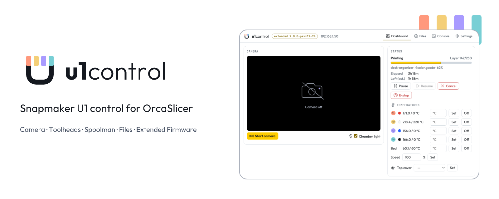
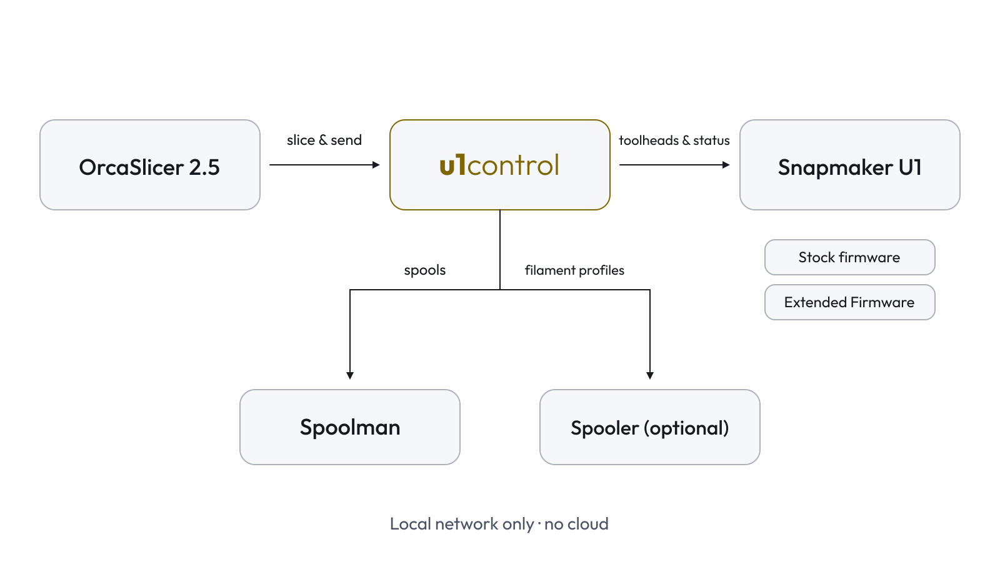
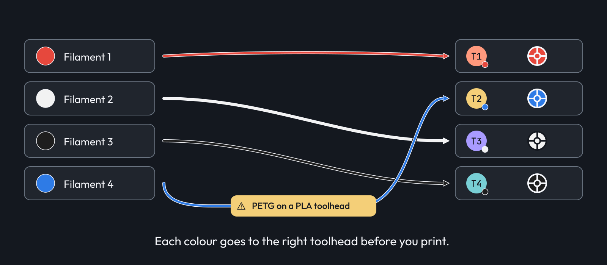
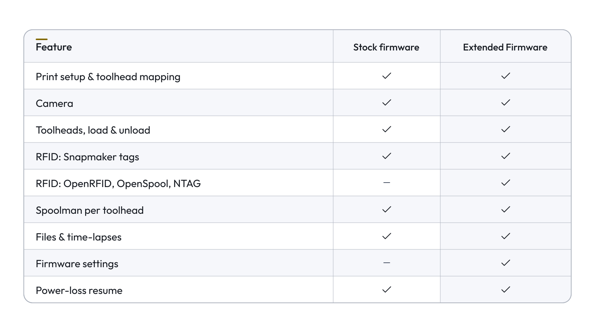
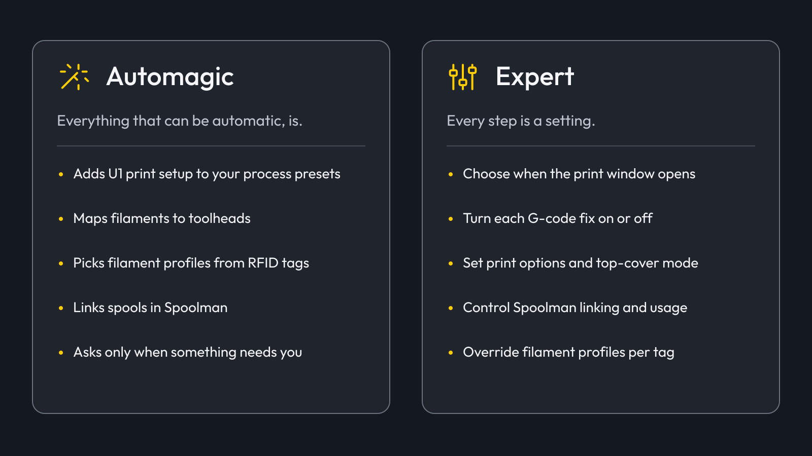
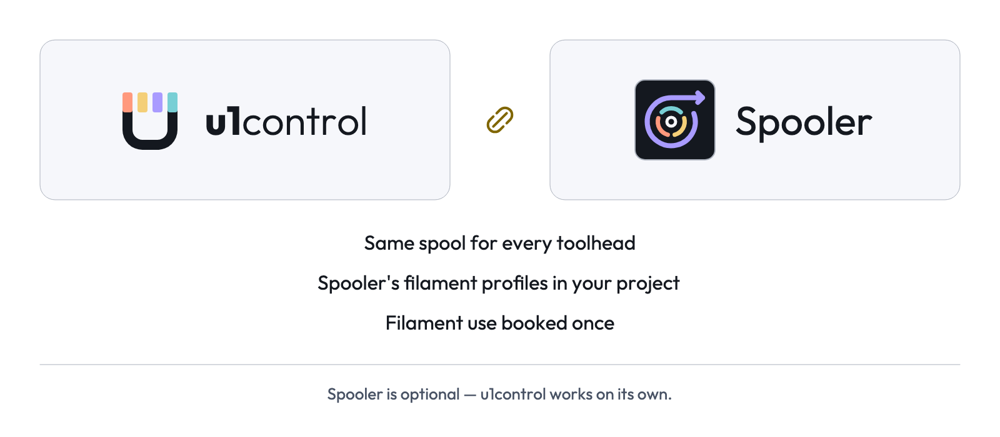
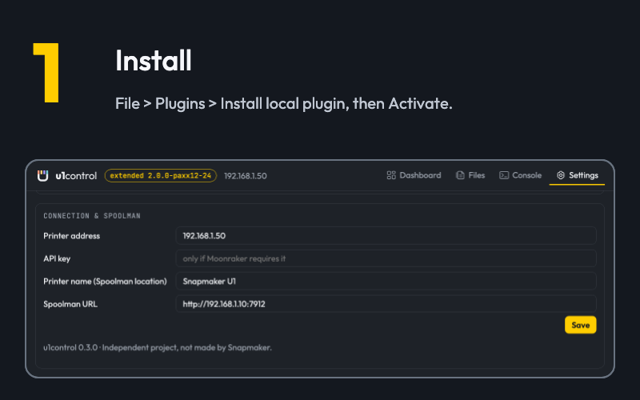
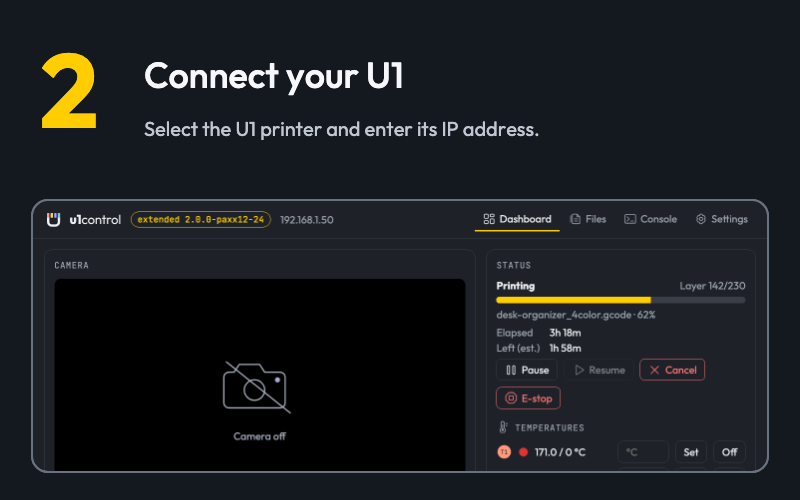
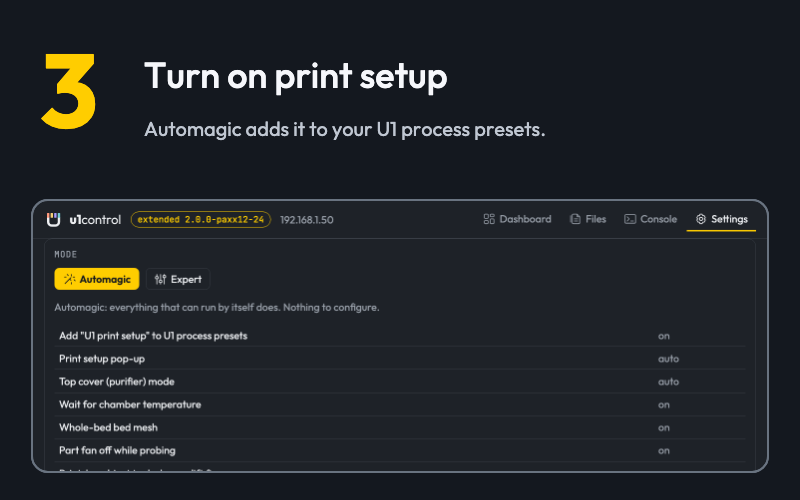
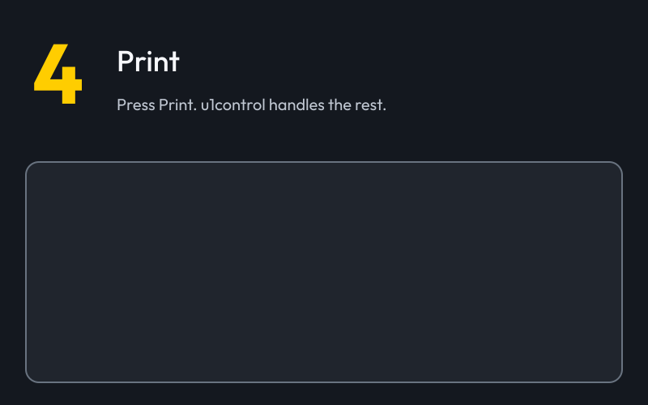

  <picture>
    <source media="(prefers-color-scheme: dark)" srcset="assets/readme/u1control-hero-dark.png">
    
  </picture>

  
  
  
  

# u1control

u1control is an OrcaSlicer 2.5 plugin for the Snapmaker U1. It adds the U1-specific parts of
Snapmaker Orca to the regular OrcaSlicer, plus a full printer tab: camera, toolheads, RFID, Spoolman,
a file manager and Extended Firmware settings.

It works with the stock Snapmaker firmware and with the
[U1 Extended Firmware](https://github.com/paxx12-snapmaker-u1/SnapmakerU1-Extended-Firmware), and
picks up the extra features of the Extended Firmware by itself. Everything stays on your local
network, and the plugin needs no extra Python packages.

u1control is an independent project. It is not made or supported by Snapmaker.

  
  
  
  
  
  
  
  

## How it works

<picture>
  <source media="(prefers-color-scheme: dark)" srcset="assets/diagrams/how-it-works-dark.png">
  
</picture>

## Features

### Print setup

When you press **Print** for a U1, u1control decides which toolhead prints each filament before the
file leaves OrcaSlicer, the way Snapmaker Orca does.

- Filaments are matched to the four toolheads by material, then material family, then nearest colour.
  Empty heads and material mismatches are flagged before anything is sent.
- The print options go to the printer with the same commands Snapmaker Orca uses: auto bed leveling,
  flow calibration and time-lapse, plus auto-refill, tangle detection, unload when done and light off
  when done when the firmware offers them.
- The top-cover mode follows Snapmaker's rule for the filaments in the print, or the mode you pick.
- Nothing is sent while the U1 is printing, loading, calibrating or updating.

On every U1 slice u1control also fixes the G-code. Each fix can be turned off in Expert mode.

| Fix | Why |
|---|---|
| Top-cover line set to the chosen mode | custom start G-codes lose it, and the profile's own line ignores the pop-up |
| Chamber wait after the bed heats up | some start G-codes leave it out |
| Whole-bed 11×11 mesh instead of adaptive | the U1 keeps one saved mesh, so a small patch would be reused by later prints |
| Part fan off while homing Z and probing | as Snapmaker Orca does |
| Absolute tool-change lift in print-by-object | Snapmaker Orca fix #958; the stock 2.5 profile can lift too little or too much |
| Real total layer count | the touchscreen's layer counter is right |
| File colours match the assigned toolheads | the printer's file list shows the real colours |

### U1 Control tab

- **Dashboard:** everything about the printer on one page.
  - Camera, status and progress, pause, resume, cancel and emergency stop, temperatures with each
    head's filament, speed, chamber light and top cover.
  - The four toolheads: filament and colour, RFID tag details (Snapmaker tags, and with the Extended
    Firmware OpenRFID, OpenSpool, NTAG and external readers), edit, load, unload and read the tag again.
  - Spoolman: one spool per toolhead, picked from a list that shows each spool's colour, brand,
    material and grams left. Pick a spool and its filament is written to the head. Change the filament
    on the printer and the closest spool is linked. Each head's filament use is recorded when the print
    finishes.
  - With the Extended Firmware: the printer's touchscreen (Remote Screen), live, and tappable.
  - Resume or discard a print interrupted by a power cut, and see the printer's error list.
- **Files:** browse, print and delete G-code files; browse, save and delete time-lapses. Create
  folders, and move files and folders with **Move** or by dragging a row onto a folder.
- **Console:** send G-code.
- **Settings:** Automagic or Expert, Spoolman, the printer's print options, bed mesh, input shaper
  and flow calibration, the Extended Firmware's settings (web UI, camera, RFID system, Spoolman, Remote
  Screen, SSH and more) with restart Klipper, restart Moonraker and reboot, Spooler, and the connection.

### Firmware support

<picture>
  <source media="(prefers-color-scheme: dark)" srcset="assets/diagrams/firmware-support-dark.png">
  
</picture>

### Automagic and Expert

Automagic is the default: everything that can run by itself does, and the print pop-up only opens
when a decision is needed. Expert turns each step into a setting. Your Expert choices are kept while
Automagic is on. See [docs/settings.md](docs/settings.md) for every setting.

### Works with Spooler

<picture>
  <source media="(prefers-color-scheme: dark)" srcset="assets/integration/u1control-works-with-spooler-dark.png">
  
</picture>

[Spooler](https://github.com/bloodf/spooler) turns your Spoolman filaments into OrcaSlicer filament
profiles. With Spooler installed, u1control applies Spooler's profile for the spool in each toolhead
and steps aside while Spooler's "Keep Slots Synced" runs. Without it, u1control's own Spoolman tools
do the job. The two plugins agree on which spool is in which toolhead and record filament use only
once. The details are in [docs/spooler-contract.md](docs/spooler-contract.md).

### Plugins > Run

- **Check U1 connection**
- **Sync U1 toolheads to project filaments:** puts the right filament profile for each toolhead into
  the project, using the RFID tag first.
- **Apply Snapmaker Orca U1 process tuning:** asks first, then changes the process preset to Snapmaker
  Orca's U1 values. It also fixes the 0.25 mm layer height in OrcaSlicer 2.5's
  `0.18 Standard @Snapmaker U1 (0.6 nozzle)`. The preset stays unsaved until you save it.

## Install

  
  
  
  

1. Subscribe to u1control on the OrcaSlicer Plugin Hub, or download `u1control_any.whl` from the
   [latest release](../../releases/latest) and use **File > Plugins > Install local plugin**.
2. Tick **Activate** and allow the background thread when OrcaSlicer asks.
3. Select your Snapmaker U1 printer and enter its IP address (the Wi-Fi icon next to the printer name).
4. In Automagic mode u1control adds **U1 print setup** to your U1 process preset. Save the preset to
   keep it. In Expert mode, add it yourself under **Process > Others > Slicing Pipeline Plugin**.

The **U1 Control** tab appears next to Prepare, Preview and Device.

Requirements: OrcaSlicer 2.5.0 or newer, and a Snapmaker U1 on the same network.

## Documentation

- [Architecture](docs/architecture.md): modules, threads and the page protocol
- [Definitions](docs/definitions.md): the terms used in the code and the UI
- [Settings](docs/settings.md): every setting and its Automagic value
- [Firmware](docs/firmware.md): the printer commands and endpoints u1control uses
- [Spooler contract](docs/spooler-contract.md): how u1control and Spooler share work
- [Contributing](CONTRIBUTING.md), [Code of conduct](CODE_OF_CONDUCT.md) and [Security](SECURITY.md)

Questions and ideas: [Discussions](https://github.com/bloodf/u1control/discussions). Bugs: [Issues](https://github.com/bloodf/u1control/issues).

## Credits

u1control is built from the public sources of Snapmaker's
[u1-klipper](https://github.com/Snapmaker/u1-klipper),
[u1-moonraker](https://github.com/Snapmaker/u1-moonraker),
[u1-fluidd](https://github.com/Snapmaker/u1-fluidd),
[Snapmaker/OrcaSlicer](https://github.com/Snapmaker/OrcaSlicer) and the
[U1 Extended Firmware](https://github.com/paxx12-snapmaker-u1/SnapmakerU1-Extended-Firmware).
Ideas came from the SnapSend, U1 Sync & Send, Set & Send and
[orca-snapmaker-u1-camera-plugin](https://github.com/lanwen/orca-snapmaker-u1-camera-plugin) plugins.

Fonts in `assets/fonts` (Outfit, JetBrains Mono) are under the SIL Open Font License.

License: [GPL-3.0-only](LICENSE).
