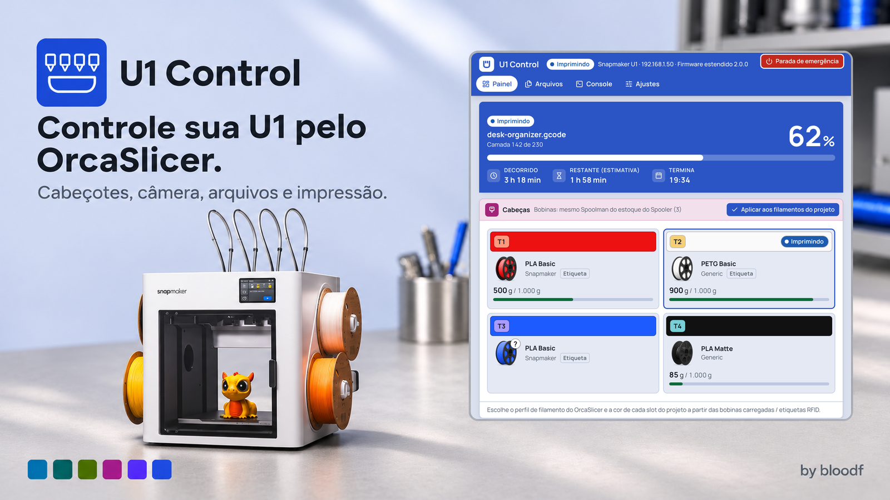
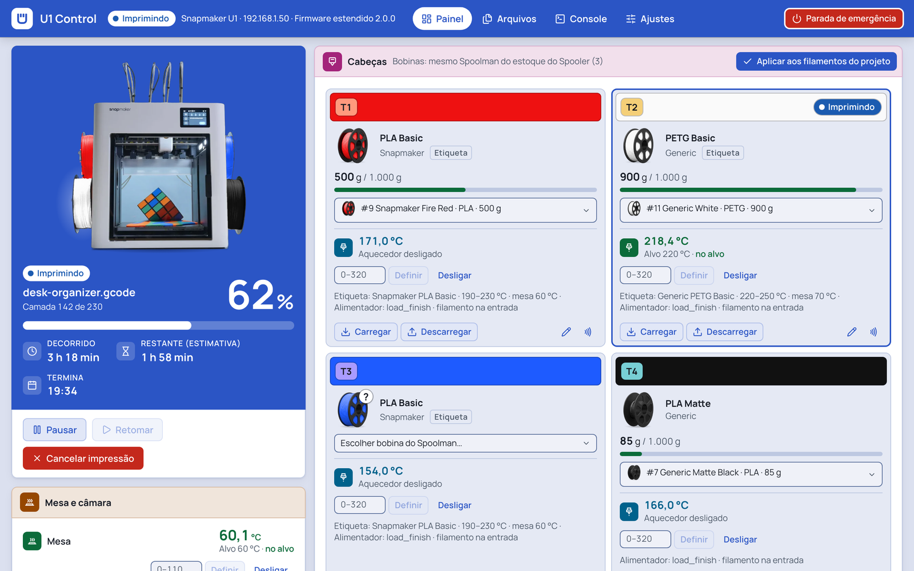
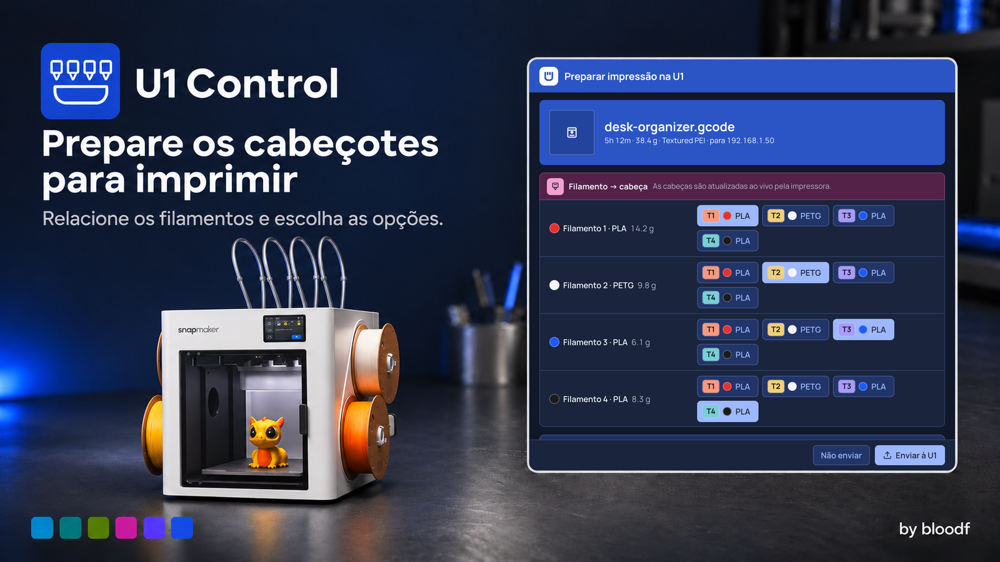
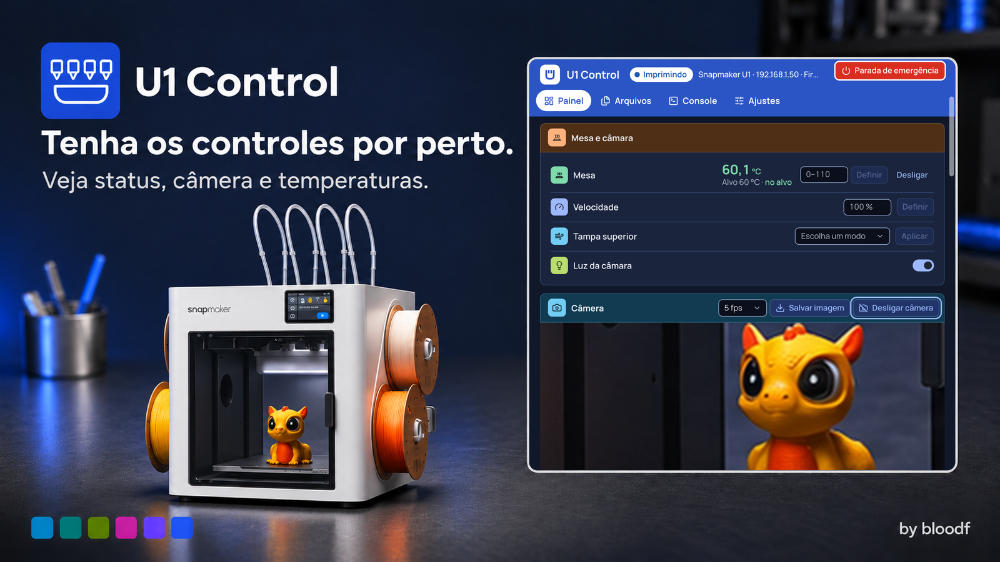
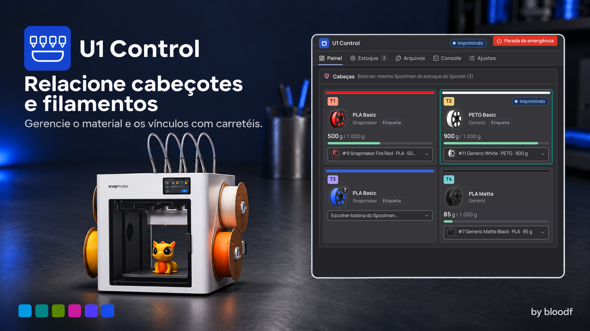
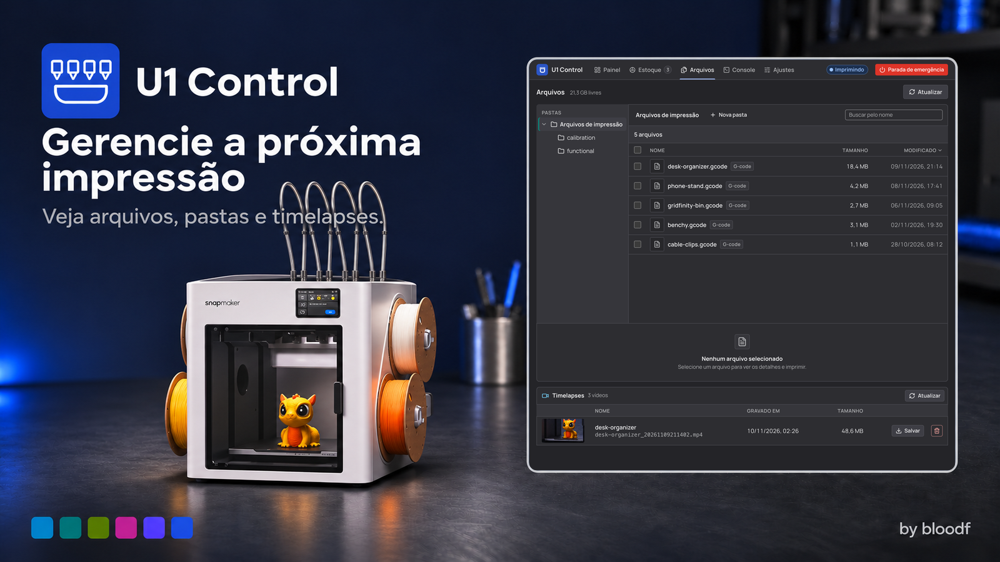
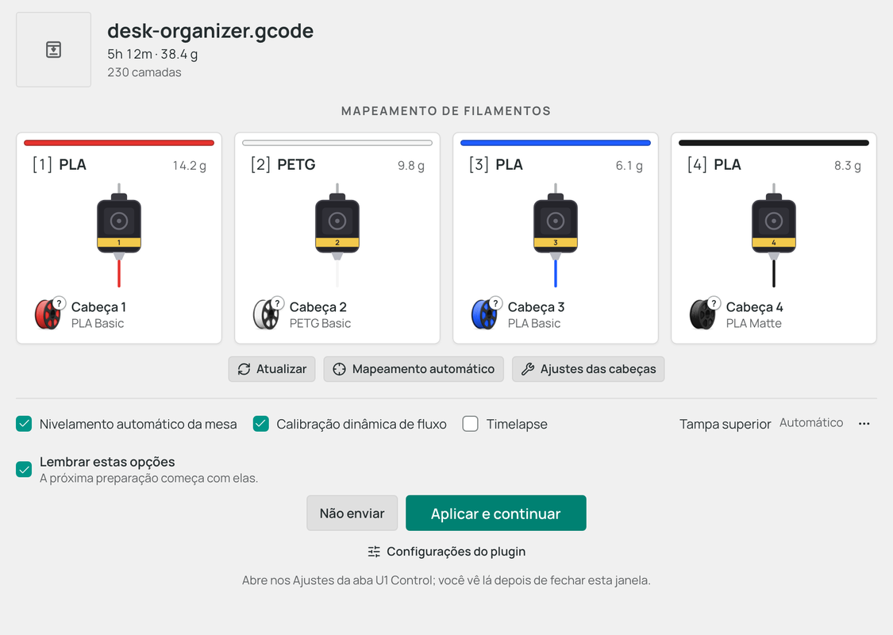

  <picture>
    <source media="(prefers-color-scheme: dark)" srcset="assets/readme/u1control-hero-dark-pt-BR.png">
    
  </picture>

<h1 align="center">🔵 U1 Control</h1>

<b>Controle a Snapmaker U1 pelo OrcaSlicer: cabeças, câmera, arquivos.</b> Um plugin para o OrcaSlicer · by bloodf

  
  
  
  

  <a href="#-instalação">Instalação</a> · <a href="#-recursos">Recursos</a> · <a href="#-como-usar">Como usar</a> · <a href="#-perguntas-frequentes">Perguntas frequentes</a> · <a href="README.md">English</a>

## ✨ O que faz

O U1 Control é um plugin do OrcaSlicer 2.5 para a Snapmaker U1. Ele acrescenta uma aba da impressora com a câmera, as quatro cabeças, as etiquetas RFID, as bobinas do Spoolman, um gerenciador de arquivos e os ajustes do firmware. Quando você aperta **Imprimir**, ele relaciona cada filamento a uma cabeça e corrige o G-code da U1, como o Snapmaker Orca faz. Funciona com o firmware original da Snapmaker e com o [U1 Extended Firmware](https://github.com/paxx12-snapmaker-u1/SnapmakerU1-Extended-Firmware), fica só na sua rede local e não precisa de pacotes Python extras.

  <picture>
    <source media="(prefers-color-scheme: dark)" srcset="assets/readme/u1control-screenshot-dashboard-dark-pt-BR.png">
    
  </picture>

## 📦 Instalação

Abra o [U1 Control no Orca Cloud](https://cloud.orcaslicer.com/p/55b8c347d443) e assine; depois marque **Activate** em **File > Plugins** no OrcaSlicer.

A partir de um arquivo:

1. Baixe `u1control_any.whl` da [última versão](https://github.com/bloodf/u1control/releases/latest).
2. No OrcaSlicer, abra **File > Plugins > Install local plugin** e escolha o arquivo.
3. Marque **Activate** e permita a thread em segundo plano quando o OrcaSlicer perguntar.

| Requisito | Detalhe |
|---|---|
| OrcaSlicer | 2.5.0 ou mais novo |
| Impressora | Snapmaker U1 na mesma rede do computador |
| Firmware | Firmware original da Snapmaker ou U1 Extended Firmware |
| Spoolman | Opcional |
| Pacotes Python | Nenhum |

## 🧰 Recursos

<table>
  <tr>
    <td width="50%" valign="top">
      
      
<b>Preparo da impressão</b> Cada filamento é relacionado a uma cabeça por material e cor antes de o arquivo sair do OrcaSlicer.

    </td>
    <td width="50%" valign="top">
      
      
<b>Painel</b> Status, temperaturas, câmera, pausar, retomar, cancelar e parada de emergência em uma página.

    </td>
  </tr>
  <tr>
    <td width="50%" valign="top">
      
      
<b>Cabeças e bobinas</b> Veja e edite o filamento de cada cabeça, leia a etiqueta RFID e vincule uma bobina do Spoolman por cabeça.

    </td>
    <td width="50%" valign="top">
      
      
<b>Arquivos e timelapses</b> Imprima, renomeie, mova e apague arquivos da impressora e salve os vídeos de timelapse no computador.

    </td>
  </tr>
</table>

| Recurso | O que você tem |
|---|---|
| Timelapses | A página Arquivos lista todos os vídeos que a U1 gravou, do mais novo ao mais antigo, com a imagem de capa, o nome da impressão, a data e o tamanho. **Salvar** copia o vídeo para `Downloads/u1control`; **Apagar** pergunta antes e remove o vídeo e as capas da impressora. As duas funcionam durante a impressão. |
| Opções de impressão | Nivelamento automático da mesa, calibração de fluxo e timelapse, enviados com os comandos que o Snapmaker Orca usa. Reabastecimento automático, detecção de emaranhado, descarregar ao terminar e apagar a luz ao terminar quando o firmware oferece. |
| Correções de G-code | Sete correções em todo fatiamento para a U1: linha da tampa superior, espera da câmara, malha 11×11 da mesa inteira, ventilador da peça desligado na sondagem, elevação na troca de ferramenta ao imprimir por objeto, contagem real de camadas e cores do arquivo. Cada uma pode ser desligada no modo Especialista. |
| Agente de impressora | O U1 Control pode ser o agente de impressora da U1, e então a janela Imprimir e a aba Device do próprio OrcaSlicer funcionam com a U1. |
| RFID | Etiquetas Snapmaker nos dois firmwares. OpenRFID, OpenSpool, NTAG e leitores externos com o Extended Firmware. |
| Spoolman | Uma lista de bobinas com cor, marca, material e gramas restantes. O consumo de filamento é registrado uma vez por impressão: pelo U1 Control no firmware original, pela impressora no Extended Firmware ([o que é coberto](docs/spooler-contract.md#filament-use)). |
| Tela remota | Com o Extended Firmware, a tela da impressora fica no Painel, ao vivo, e você pode tocar nela. |
| Recuperação após queda de energia | Retome ou descarte uma impressão interrompida por falta de energia e veja a lista de erros da impressora. |
| Console | Envie G-code e leia as respostas da impressora. `M112` aciona a parada de emergência. |
| Ajustes | Malha da mesa, input shaper e calibração de fluxo, os ajustes do Extended Firmware, reiniciar o Klipper, reiniciar o Moonraker e reiniciar a impressora. |
| Plugins > Run | **Check U1 connection**, **Sync U1 toolheads to project filaments** e **Apply Snapmaker Orca U1 process tuning**. |
| Spooler | Com o [Spooler](https://github.com/bloodf/spooler) instalado, cada cabeça recebe o perfil de filamento do Spooler e o Painel lista o estoque do Spooler. |

Quase tudo funciona no firmware original:

| Recurso | Firmware original | Extended Firmware |
|---|:---:|:---:|
| Preparo da impressão e escolha das cabeças | sim | sim |
| Câmera | sim | sim |
| Cabeças, carregar e descarregar | sim | sim |
| RFID: etiquetas Snapmaker | sim | sim |
| RFID: OpenRFID, OpenSpool, NTAG | não | sim |
| Spoolman por cabeça | sim | sim |
| Arquivos e timelapses | sim | sim |
| Ajustes do firmware | não | sim |
| Retomar após queda de energia | sim | sim |

Os detalhes estão em [docs/features.md](docs/features.md) e todos os ajustes em [docs/settings.md](docs/settings.md) (em inglês).

## 🛠️ Como usar

1. No OrcaSlicer, selecione a sua Snapmaker U1 e informe o endereço IP dela (o ícone de Wi-Fi ao lado do nome da impressora).
2. Abra a aba **U1 Control**, ao lado de Prepare, Preview e Device. O **Painel** mostra a impressão, a mesa e as quatro cabeças. **Ligar câmera** liga a imagem.
3. No modo Automágico o plugin acrescenta **U1 print setup** ao seu perfil de processo da U1. Salve o perfil para manter. No modo Especialista, acrescente você mesmo em **Process > Others > Slicing Pipeline Plugin**.
4. Fatie e aperte **Imprimir**. Quando é preciso escolher, a janela **Preparar impressão na U1** abre: confira **Filamento → cabeça** e **Opções de impressão** e aperte **Enviar à U1**.
5. Acompanhe a impressão no **Painel**, onde ficam **Pausar**, **Retomar**, **Cancelar impressão** e **Parada de emergência**. **Arquivos** lista o que está na impressora.

  <picture>
    <source media="(prefers-color-scheme: dark)" srcset="assets/readme/u1control-screenshot-print-setup-dark-pt-BR.png">
    
  </picture>

Automágico é o modo padrão: tudo o que pode rodar sozinho roda, e a janela só abre na primeira impressão, com uma cabeça vazia, com outro material, com dois filamentos para a mesma cabeça ou sem material exatamente igual. O modo Especialista transforma cada etapa em um ajuste, e as suas escolhas ficam guardadas enquanto o Automágico está ligado.

Para usar a janela Imprimir do próprio OrcaSlicer, marque **Use printer agents instead of print hosts** em **Preferências > Developer > Experimental Features**, reinicie o OrcaSlicer e defina **Printer Agent** como `u1control` numa cópia do perfil de impressora da U1. **Ajustes > Requisitos** na aba U1 Control mostra se o OrcaSlicer usa o agente. O preparo da impressão do U1 Control abre em seguida, já com os slots escolhidos lá. [Os passos e o que cada caixa faz](docs/features.md#printer-agent).

## 🔒 Privacidade e segurança

O U1 Control fala só com a sua impressora e, se você configurar, com o seu servidor Spoolman, na sua rede local. Não tem serviço de nuvem e não envia nada para a internet.

| Ação | Detalhe |
|---|---|
| Lê | O status, os arquivos e a câmera da impressora pelo Moonraker. O G-code que o OrcaSlicer está exportando. Os arquivos `profiles.json`, `keep_slots.json` e de ajustes do Spooler, que ele nunca grava. |
| Envia | Comandos, arquivos e opções de impressão para a impressora por HTTP simples na sua rede, como o OrcaSlicer faz. Vínculos de bobina e consumo de filamento para o Spoolman. |
| Guarda | Os ajustes na pasta do próprio plugin. Uma chave de API, se você informar, fica ali e na memória; nunca vai para a página nem para os logs. Imagens e timelapses salvos vão para `Downloads/u1control`. |
| Nunca | Inicia uma impressão enquanto a U1 está imprimindo, carregando, calibrando ou atualizando. Substitui um arquivo: renomear ou mover para um nome que já existe é recusado, e um download nunca sobrescreve. Sobrescreve uma bobina RFID sem a sua confirmação. |

Apagar arquivos, carregar ou descarregar filamento, calibrar, a parada de emergência e mudanças no Extended Firmware sempre perguntam antes. Durante uma impressão, os ajustes de firmware que reiniciam o Klipper ou a impressora esperam ela terminar. Use o plugin em uma rede em que você confia: a conexão com a impressora não é criptografada.

Todos os testes automáticos rodam contra uma impressora falsa. Veja [o que os testes cobrem](docs/release.md#what-the-tests-cover-and-what-they-do-not) e o [SECURITY.md](SECURITY.md) para relatar uma vulnerabilidade.

## ❓ Perguntas frequentes

Preciso do Extended Firmware?

Não. O preparo da impressão, a câmera, as cabeças, as etiquetas RFID da Snapmaker, o Spoolman, os arquivos, os timelapses e a retomada após queda de energia funcionam no firmware original. O Extended Firmware acrescenta as etiquetas OpenRFID, OpenSpool e NTAG, os ajustes do firmware e a tela remota. O U1 Control descobre sozinho qual firmware a impressora usa.

Por que aparecem duas janelas quando clico em Imprimir?

O OrcaSlicer sempre abre a própria janela Imprimir primeiro, e nenhum plugin pode substituí-la. O preparo da impressão do U1 Control abre em seguida, já preenchido com o que você escolheu, para conferir as cabeças e as opções antes de enviar. Para pular, mude para Especialista e desligue **Mostrar o preparo antes de enviar**; um material diferente ou uma U1 ocupada continuam sendo recusados.

Por que o preparo não rodou na minha impressão?

Ele roda quando o OrcaSlicer envia a impressão pelo host de impressão da U1 (**Imprimir** ou **Enviar**). Não roda em **Exportar G-code**, em **Imprimir** na página Arquivos, nem com **Use printer agents instead of print hosts** ligado. **Ajustes > Preparo da impressão** na aba U1 Control diz se o seu perfil de processo roda o preparo.

Por que o OrcaSlicer pede para o u1control ler uma pasta temporária?

O agente de impressora lê dali o trabalho fatiado: `<temp>/orcaslicer_<id do usuário>` no macOS e no Linux. No Windows o OrcaSlicer grava o trabalho direto em `%TEMP%`, então a permissão cobre toda a pasta `%TEMP%`, só para leitura. Sem ela o agente não consegue enviar. O caminho pelo host de impressão não precisa dela.

O agente de impressora foi testado em uma U1 de verdade?

Não todo. Falta confirmar em uma impressora real: que a janela do OrcaSlicer mostra Flow Dynamics Calibration e Timelapse para este agente, que os números dos slots chegam como as cabeças 1 a 4 e que a calibração de fluxo e o timelapse definidos assim têm efeito. O [changelog](CHANGELOG.md) tem os detalhes.

Também uso o Spooler. O consumo de filamento é registrado duas vezes?

Não. Os dois plugins concordam sobre qual bobina está em qual cabeça e registram o consumo uma vez. O U1 Control dá passagem enquanto o "Keep Slots Synced" do Spooler roda. O OrcaSlicer não consegue esconder a aba de um plugin, então a aba do Spooler continua, a menos que você desligue a página dele na janela Plugins. Veja [docs/spooler-contract.md](docs/spooler-contract.md).

Uma bobina pode usar o meu perfil de filamento ajustado?

Para uma etiqueta RFID, sim: no modo Especialista, `profile_overrides` escolhe um perfil de filamento exato pelo UID da etiqueta, pelo SKU ou por marca e material ([como](docs/settings.md#profile-overrides)). Escolher um perfil por bobina do Spoolman foi pedido na [issue #11](https://github.com/bloodf/u1control/issues/11).

O U1 Control é feito pela Snapmaker?

Não. É um projeto independente, não feito nem suportado pela Snapmaker, feito a partir dos códigos públicos da Snapmaker e do U1 Extended Firmware. [Créditos](docs/credits.md).

## 🌍 Idiomas

Inglês, português do Brasil, espanhol, alemão e chinês simplificado. A página segue o idioma do OrcaSlicer (chinês tradicional mostra o simplificado; outros idiomas, inglês), ou o que você escolher em **Ajustes > Idioma**. Uma tradução para o polonês foi proposta na [issue #20](https://github.com/bloodf/u1control/issues/20).

## 🧩 Mais plugins do bloodf

| | Plugin | O que faz | |
|:-:|---|---|---|
|  | 🧩 [Organizer](https://github.com/bloodf/orca_organizer) | Organize as peças pelo contorno real e encha a mesa com mais cópias. | [Instalar](https://cloud.orcaslicer.com/p/5bf381fd42d4) |
|  | 🧲 [Embedder](https://github.com/bloodf/embedder) | Bolsos para ímãs e NFC, com a pausa na camada certa. | [Instalar](https://cloud.orcaslicer.com/p/58222d4f9e52) |
|  | 💰 [Print Calculator](https://github.com/bloodf/orca_print_calculator) | Preço de cada mesa: filamento, energia, mão de obra, taxas e margem. | [Instalar](https://cloud.orcaslicer.com/p/521c07cf6de2) |
|  | 🧵 [Spooler](https://github.com/bloodf/spooler) | Seu estoque do Spoolman dentro do OrcaSlicer, com o que resta em cada bobina. | [Instalar](https://cloud.orcaslicer.com/p/50c35dcbd6f3) |
|  | 🟣 [Kobra Control](https://github.com/bloodf/kobracontrol) | Controle a Anycubic Kobra X pelo OrcaSlicer na sua rede. | [Instalar](https://cloud.orcaslicer.com/p/59c786285255) |
|  | 🔵 **U1 Control** · você está aqui | Controle a Snapmaker U1 pelo OrcaSlicer: cabeças, câmera, arquivos. | |

Cada plugin funciona sozinho; instalados juntos, compartilham dados onde ajuda.

## 🤝 Contribuir

Relatos de problemas, logs da impressora e pull requests são bem-vindos: comece pelo [CONTRIBUTING.md](CONTRIBUTING.md). Perguntas e ideias vão para as [Discussions](https://github.com/bloodf/u1control/discussions), problemas para as [Issues](https://github.com/bloodf/u1control/issues). Os detalhes (em inglês) estão em [Features](docs/features.md), [Settings](docs/settings.md), [Architecture](docs/architecture.md), [Firmware](docs/firmware.md), [Spooler contract](docs/spooler-contract.md), [Definitions](docs/definitions.md), [Releasing](docs/release.md) e [Credits](docs/credits.md). O [Código de conduta](CODE_OF_CONDUCT.md) vale para todos que participam.

## 📄 Licença

GPL-3.0-only. Veja [LICENSE](LICENSE).

by bloodf

