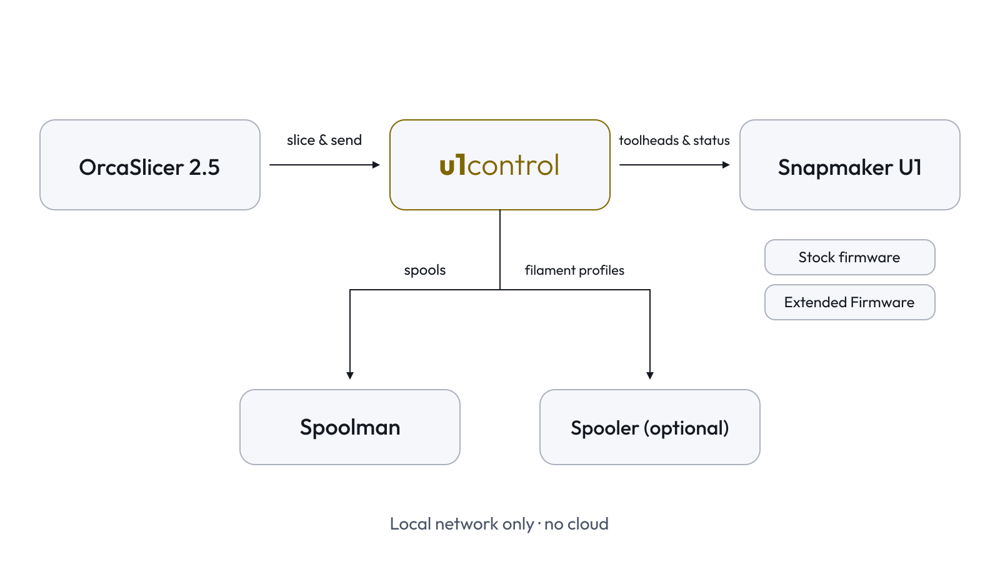
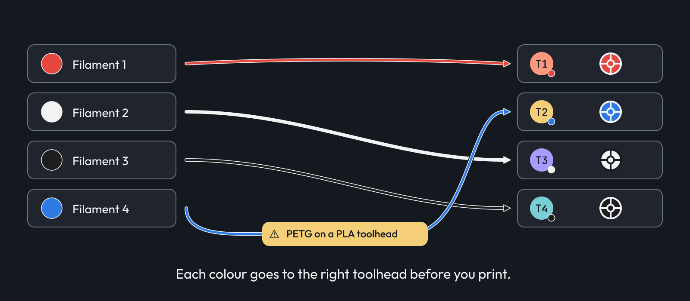
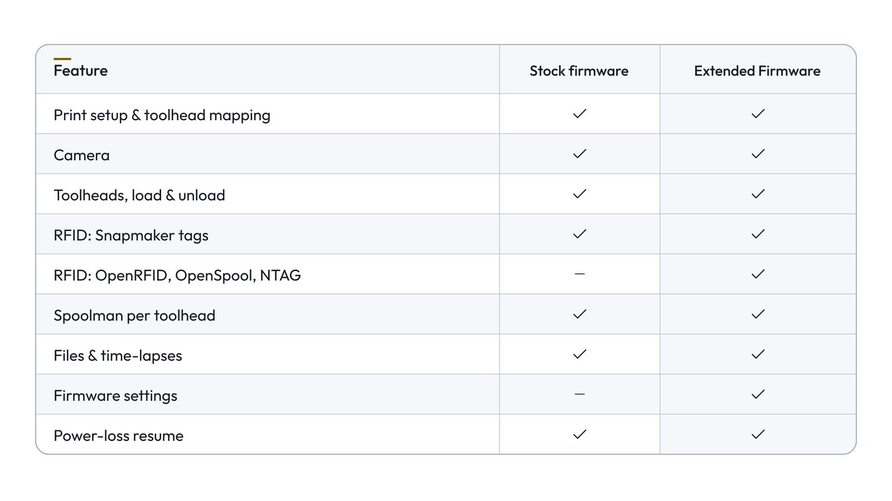
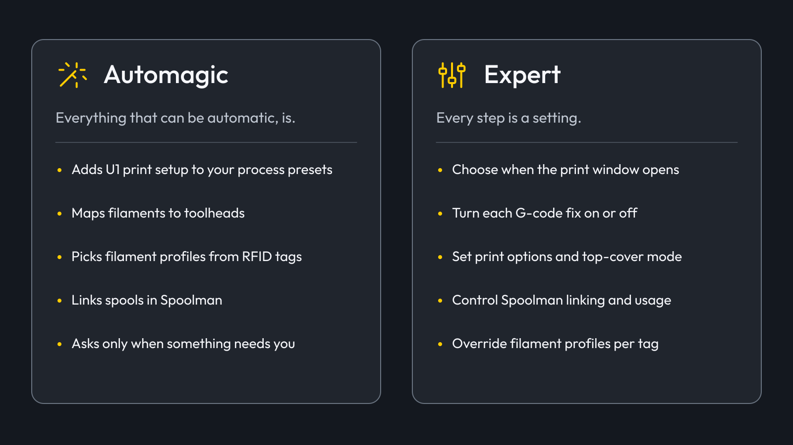
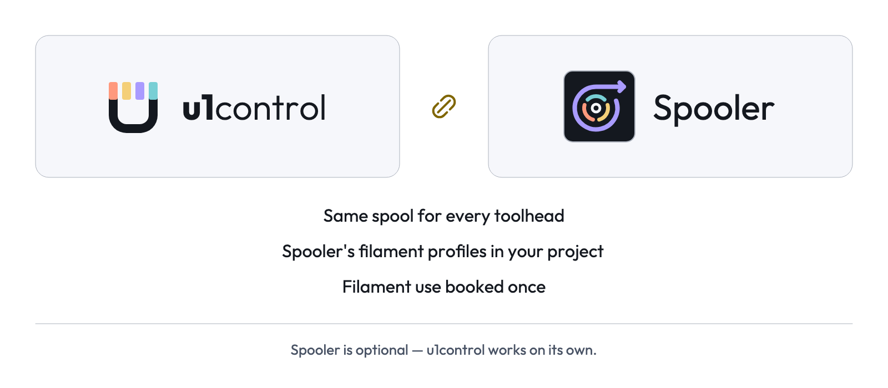

# Features in detail

The [README](../README.md) has the short version. This page keeps every detail: what each part does, when it
runs and what it leaves alone.

## How it works

<picture>
  <source media="(prefers-color-scheme: dark)" srcset="../assets/diagrams/how-it-works-dark.png">
  
</picture>

u1control works with the stock Snapmaker firmware and with the
[U1 Extended Firmware](https://github.com/paxx12-snapmaker-u1/SnapmakerU1-Extended-Firmware), and picks up the
extra features of the Extended Firmware by itself. Everything stays on your local network, and the plugin needs
no extra Python packages.

## Print setup

When you press **Print** for a U1, u1control decides which toolhead prints each filament before the
file leaves OrcaSlicer, the way Snapmaker Orca does.

- Filaments are matched to the four toolheads by material, then material family, then nearest colour.
  Empty heads and material mismatches are flagged before anything is sent.
- The print options go to the printer with the same commands Snapmaker Orca uses: auto bed leveling,
  flow calibration and time-lapse, plus auto-refill, tangle detection, unload when done and light off
  when done when the firmware offers them.
- The top-cover mode follows Snapmaker's rule for the filaments in the print, or the mode you pick.
- Nothing is sent while the U1 is printing, loading, calibrating or updating.

The window (**U1 Control — print setup**) opens before every print while **Show print setup before
sending** is on, which is the default. It shows the print and the printer, one card per filament with the head
it prints from, a top view coloured by head, **Refresh**, **Auto mapping** and **Heads settings**, the print
options, **Print preferences** and the top-cover fans. Each option appears only when the printer's command
list (Moonraker `/printer/gcode/help`) has its command. While the U1 is busy the settings can't change and
nothing is sent. With the setting off (Expert), the file goes out with the toolheads u1control matched, and a
different material, an empty toolhead or a busy U1 is refused.

Print setup runs when OrcaSlicer sends the print through the U1's print host (**Print** or **Send**).
It does not run for **Export G-code** or for **Print** on the U1 Control Files page. With OrcaSlicer's
**Use printer agents instead of print hosts** preference on, the same window opens from the printer agent
(below). **Settings > Print setup** in the U1
Control tab says whether your process preset runs it.

## Printer agent

With OrcaSlicer's printer agents, u1control can be the U1's agent instead, so OrcaSlicer's own Print
dialog and Device tab work with the U1:

1. In OrcaSlicer, open **Preferences** and turn on **Use printer agents instead of print hosts**.
2. Open your U1 printer preset, set **Printer Agent** to `u1control` and its host to the U1's IP
   address. Save the preset.

Then **Print** in OrcaSlicer opens its own print dialog:

- The four toolheads are the four slots, each with its filament and colour. Pick a slot for each
  filament; a filament you leave unpicked gets the toolhead u1control matches by material and colour.
- **Auto Bed Leveling**, **Flow Dynamics Calibration** and **Timelapse** start ticked in OrcaSlicer's
  dialog, so U1 Control's own print options decide what is used: an option runs only when its box is ticked
  **and** it is on in U1 Control (by default bed leveling and flow calibration are on, time-lapse is off).
  Unticking a box turns that option off. OrcaSlicer remembers the box; tick it again to go back to
  U1 Control's setting. Auto-refill, tangle detection, unload when done and
  light off when done come from the U1 Control settings (the options you last chose), or the printer's own.
- Then U1 Control's own **print setup** window opens on top, before anything is sent, while **Show print
  setup before sending** is on. It starts from the slots and options picked in OrcaSlicer's dialog. Change
  any head or option there; **Remember these options** keeps them for the next print. **Don't send**, or
  cancelling the job in OrcaSlicer, sends nothing; after 15 minutes the window gives up and nothing is sent.
- Two dialogs, one after the other: OrcaSlicer always opens its own Print dialog first (its
  SelectMachineDialog), and no plugin hook can replace or skip it. U1 Control's window is the second step,
  started from what you picked in the first.
- u1control applies the same G-code fixes as below, then uploads the file, sends the toolhead map and
  options, and starts the print.
- A busy U1 (printing, loading, calibrating, updating) stops the print before the window opens. An empty
  toolhead or another material in a picked slot needs the window's "send anyway" check (without the window,
  it stops the print) before anything is sent, with the reason in OrcaSlicer's dialog. Both are checked
  again after the upload; if something changed, the file stays on the U1 and the print isn't started.

**Send** uploads the fixed G-code without starting it, and refuses the name of the file the U1 is printing. The Device tab shows status, temperatures, the
toolheads and the light, with pause, resume, stop and the light switch.

The print-host path (U1 print setup) keeps working as before; use one or the other.

When the plugin loads, OrcaSlicer asks once to let u1control read the sliced job from its temp folder:
`<temp>/orcaslicer_<user id>` on macOS and Linux. On Windows OrcaSlicer writes the job straight into
`%TEMP%`, so the grant covers your whole `%TEMP%` folder (read only). Without it, the agent can't send.

Em português: usar o u1control como agente de impressora

1. No OrcaSlicer, abra **Preferências** e ligue **Use printer agents instead of print hosts**.
2. Abra o perfil de impressora da U1, defina **Printer Agent** como `u1control` e o host como o IP da
   U1. Salve o perfil.

A janela **Imprimir** do próprio OrcaSlicer passa a mostrar as quatro cabeças como quatro slots, com
filamento e cor. As caixas **Auto Bed Leveling**, **Flow Dynamics Calibration** e **Timelapse** já vêm
marcadas, então as opções de impressão do U1 Control decidem: uma opção só roda com a caixa marcada **e**
ligada no U1 Control (por padrão nivelamento e calibração de fluxo ligados, time-lapse desligado); desmarcar
a caixa a desliga. O OrcaSlicer lembra a caixa; marque-a de novo para voltar ao ajuste do U1 Control. Reabastecimento automático, detecção de
emaranhado, descarregar ao terminar e apagar a luz ao terminar vêm dos ajustes do U1 Control. O u1control
abre em seguida a janela **Preparar impressão na U1** (mesma regra de **Ajustes > Janela de preparo**),
já com os slots e opções escolhidos, a impressora, o carretel do Spoolman de cada cabeça e um aviso quando a
cor é outra; **Lembrar estas opções** guarda as escolhas e **Não enviar** não envia nada. O u1control
aplica as mesmas correções de G-code, envia o arquivo, o mapa das cabeças e as opções, e inicia a
impressão. Uma U1 ocupada, uma cabeça vazia ou outro material no slot escolhido impedem o envio, com o
motivo na janela do OrcaSlicer. O caminho pelo host de impressão (preparo de impressão da U1) continua
funcionando.

Not yet confirmed on a real printer: that OrcaSlicer's dialog shows Flow Dynamics Calibration and
Timelapse for this agent, that its slot numbers arrive as the toolheads 1 to 4, and that flow calibration
and time-lapse set this way take effect. See the [changelog](../CHANGELOG.md).

## G-code fixes

On every U1 slice u1control also fixes the G-code. Each fix can be turned off in Expert mode.

| Fix | Why |
|---|---|
| Top-cover line set to the chosen mode | custom start G-codes lose it, and the profile's own line ignores the pop-up |
| Chamber wait after the bed heats up | some start G-codes leave it out |
| Whole-bed 11×11 mesh instead of adaptive | the U1 keeps one saved mesh, so a small patch would be reused by later prints |
| Part fan off while homing Z and probing | as Snapmaker Orca does |
| Absolute tool-change lift in print-by-object | Snapmaker Orca fix #958; the stock 2.5 profile can lift too little or too much |
| Real total layer count | the touchscreen's layer counter is right |
| File colours match the assigned toolheads | the printer's file list shows the real colours |

## U1 Control tab

- **Dashboard:** everything about the printer on one page.
  - Camera, status and progress, pause, resume, cancel and emergency stop, temperatures with each
    head's filament, speed, chamber light and top cover. **Save picture** keeps the camera picture on
    screen in `Downloads/u1control`.
  - The four toolheads: filament and colour, RFID tag details (Snapmaker tags, and with the Extended
    Firmware OpenRFID, OpenSpool, NTAG and external readers), edit, load, unload and read the tag again.
  - Spoolman: one spool per toolhead, picked from a list that shows each spool's colour, brand,
    material and grams left. Pick a spool and its filament is written to the head. Change the filament
    on the printer and the closest spool is linked. For prints sent through the U1 print setup, each
    head's estimated filament use is recorded when the print finishes (stock firmware; see
    [the Spooler contract](spooler-contract.md#filament-use) for what is and isn't covered).
  - With the Extended Firmware: the printer's touchscreen (Remote Screen), live, and tappable.
  - Resume or discard a print interrupted by a power cut, and see the printer's error list.
- **Files:** browse, print and delete G-code files. Create
  folders, rename and move files and folders (**Move**, or drag a row onto a folder), and filter the
  list by name. Each print file shows its estimated time and filament. Nothing is ever replaced: a
  rename or move onto a name the folder already has is refused.
  - **Time-lapses:** every video the U1 recorded, newest first, with its cover picture, the print's
    name, the date and the size. **Save** copies the video to `Downloads/u1control` on your computer;
    **Delete** asks first, then removes the video and its cover pictures from the printer. Both work
    while the U1 prints.
- **Console:** send G-code and see the printer's replies; `M112` runs the E-stop.
- **Settings:** Automagic or Expert, Spoolman, the printer's print options, bed mesh, input shaper
  and flow calibration, the Extended Firmware's settings (web UI, camera, RFID system, Spoolman, Remote
  Screen, SSH and more) with restart Klipper, restart Moonraker and reboot, Spooler, and the connection.
  While a print runs, firmware settings that restart Klipper or reboot the printer, Restart Klipper and
  Reboot wait until it ends ([which ones](firmware.md#firmware-settings-during-a-print)).

## Firmware support

<picture>
  <source media="(prefers-color-scheme: dark)" srcset="../assets/diagrams/firmware-support-dark.png">
  
</picture>

## Automagic and Expert

Automagic is the default: everything that can run by itself does, and the print pop-up only opens
when a decision is needed. Expert turns each step into a setting. Your Expert choices are kept while
Automagic is on. See [settings.md](settings.md) for every setting.

## Works with Spooler

<picture>
  <source media="(prefers-color-scheme: dark)" srcset="../assets/integration/u1control-works-with-spooler-dark.png">
  
</picture>

[Spooler](https://github.com/bloodf/spooler) turns your Spoolman filaments into OrcaSlicer filament
profiles. With Spooler installed, u1control applies Spooler's profile for the spool in each toolhead
and steps aside while Spooler's "Keep Slots Synced" runs. Without it, u1control's own Spoolman tools
do the job. The two plugins agree on which spool is in which toolhead and record filament use only
once. While Spooler runs in the same OrcaSlicer, the U1 Control Dashboard also lists Spooler's stock
(search, filters, low stock) and links a spool to a toolhead from there. OrcaSlicer can't hide a
plugin's tab, so Spooler's own tab stays unless you turn its page off in the Plugins dialog. The
details are in [spooler-contract.md](spooler-contract.md).

## Plugins > Run

- **Check U1 connection**
- **Sync U1 toolheads to project filaments:** puts the right filament profile for each toolhead into
  the project, using the RFID tag first.
- **Apply Snapmaker Orca U1 process tuning:** asks first, then changes the process preset to Snapmaker
  Orca's U1 values. It also fixes the 0.25 mm layer height in OrcaSlicer 2.5's
  `0.18 Standard @Snapmaker U1 (0.6 nozzle)`. The preset stays unsaved until you save it.

## Install, step by step

1. Subscribe to U1 Control on [Orca Cloud](https://cloud.orcaslicer.com/p/55b8c347d443), or download
   `u1control_any.whl` from the [latest release](https://github.com/bloodf/u1control/releases/latest) and use
   **File > Plugins > Install local plugin**.
2. Tick **Activate** and allow the background thread when OrcaSlicer asks.
3. Select your Snapmaker U1 printer and enter its IP address (the Wi-Fi icon next to the printer name).
4. In Automagic mode u1control adds **U1 print setup** to your U1 process preset. Save the preset to
   keep it. In Expert mode, add it yourself under **Process > Others > Slicing Pipeline Plugin**.

The **U1 Control** tab appears next to Prepare, Preview and Device.

Requirements: OrcaSlicer 2.5.0 or newer, and a Snapmaker U1 on the same network.
