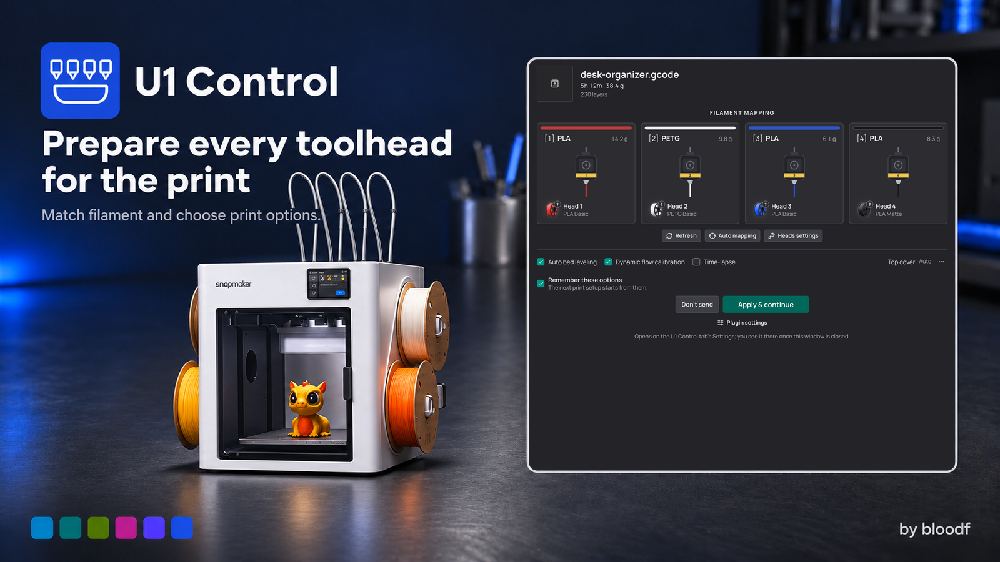
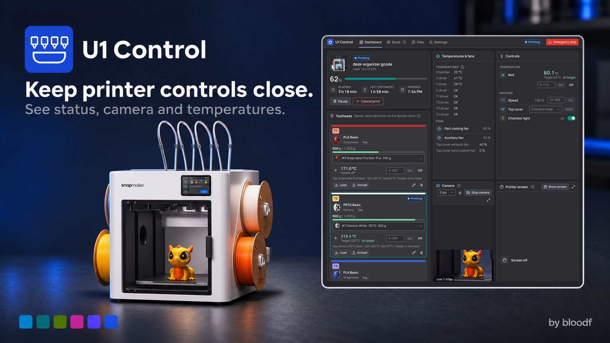
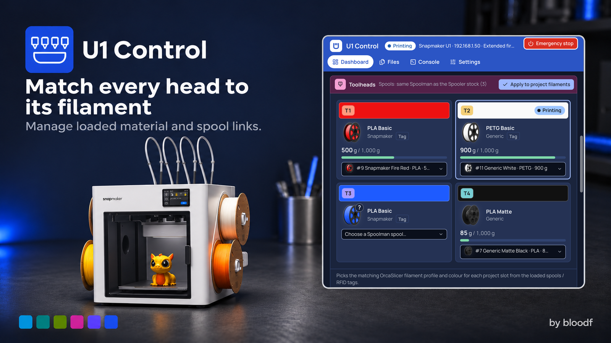
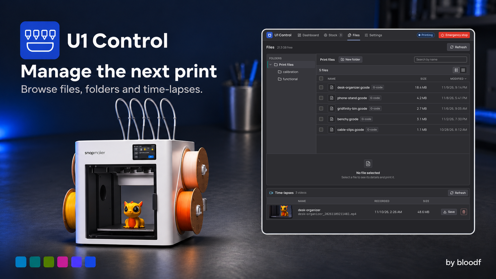
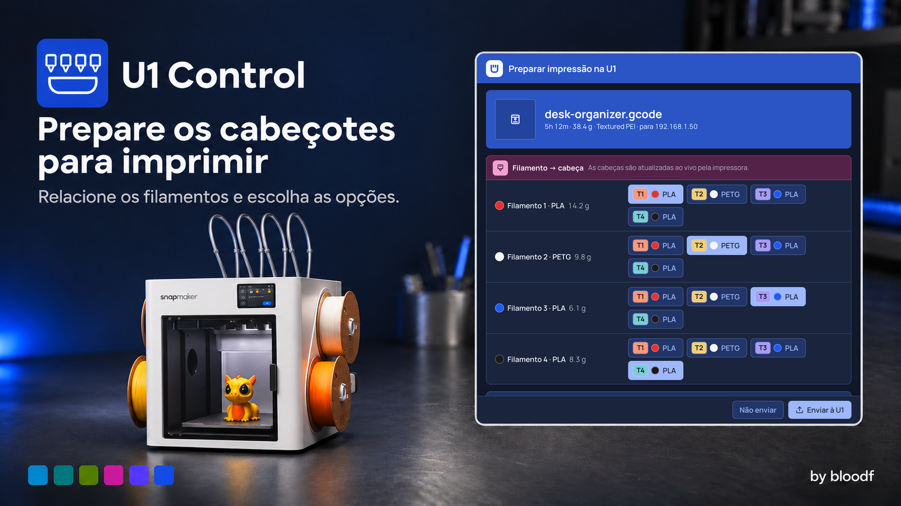
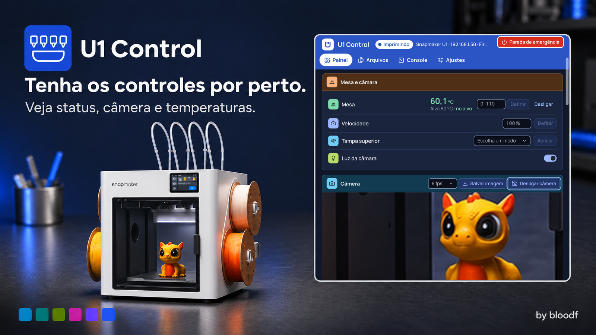
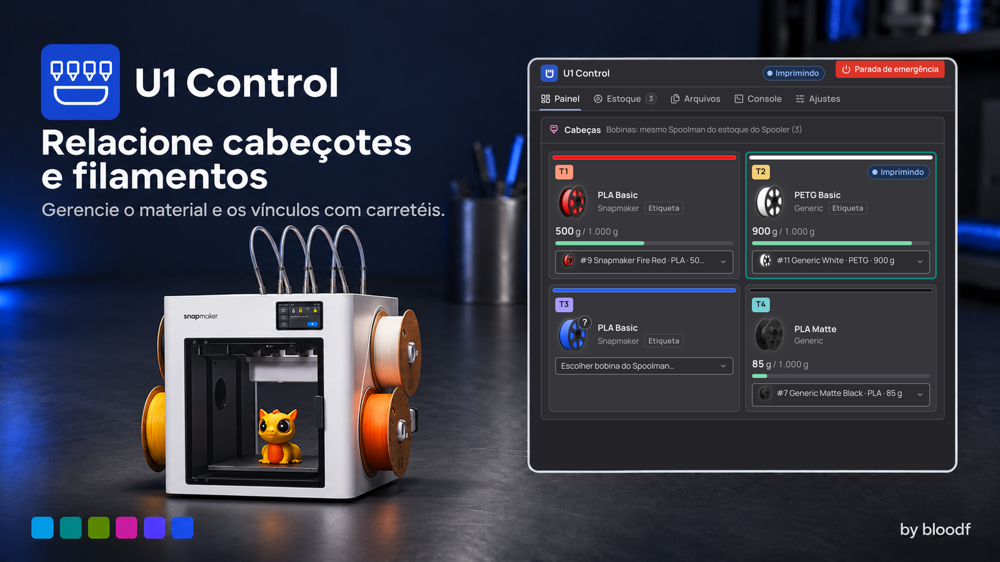
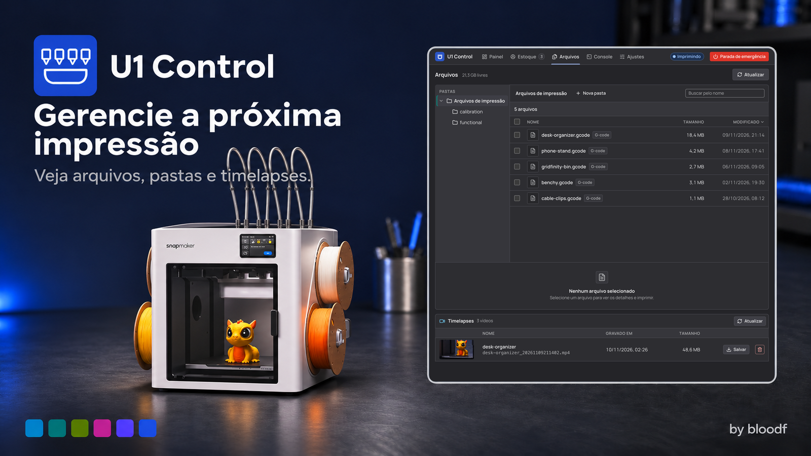

# Orca Cloud description

The text of the [U1 Control listing](https://cloud.orcaslicer.com/p/55b8c347d443). Paste the English block into
the English description and the Portuguese block into the Portuguese one. Each block stays under Orca Cloud's
4000 characters. The images it embeds are served from `main`, so they show once this file's commit is merged.
The listing's own images (tile, main, gallery) are in [release.md](release.md#orca-cloud-listing).

Keep the plugin list in step with the README's "More plugins by bloodf" table.

## English

```markdown
Run the Snapmaker U1 from OrcaSlicer: toolheads, camera, files.

## What you need

- OrcaSlicer 2.5.0 or newer
- A Snapmaker U1 on the same network, with the stock firmware or the U1 Extended Firmware
- Spoolman, only if you want a spool per toolhead

## What it does

When you press **Print**, each filament is matched to one of the four toolheads and the U1 G-code is fixed, the way Snapmaker Orca does.

{align=center}

The Dashboard shows status, temperatures and the camera, with pause, resume, cancel and emergency stop.

{align=center}

Each toolhead shows its filament, its RFID tag and its Spoolman spool with the grams left.

{align=center}

Files on the printer can be printed, renamed, moved and deleted, and time-lapse videos saved to your computer.

{align=center}

Automagic mode runs every step it can by itself and asks only when a choice is needed. Expert mode turns each step into a setting.

## How to start

1. Subscribe, open **File > Plugins**, click **Refresh** and tick **Activate**. Allow the background thread.
2. Select your Snapmaker U1 printer and enter its IP address (the Wi-Fi icon next to the printer name). The **U1 Control** tab appears next to Prepare and Preview.
3. Automagic adds **U1 print setup** to your U1 process preset. Save the preset, slice and press **Print**.

## Privacy

U1 Control talks only to your printer and, if you set one up, your Spoolman server, on your local network. It has no cloud service and sends nothing to the internet. Deleting files, loading or unloading filament, calibration and emergency stop ask first.

Independent project, not made or supported by Snapmaker.

## Languages

English and Brazilian Portuguese.

## More plugins by bloodf

- [Organizer](https://cloud.orcaslicer.com/p/5bf381fd42d4): Arrange parts by their real outline and fill a plate with more copies.
- [Embedder](https://cloud.orcaslicer.com/p/58222d4f9e52): Magnet and NFC pockets, with the pause at the right layer.
- [Print Calculator](https://cloud.orcaslicer.com/p/521c07cf6de2): Price every plate: filament, energy, labour, fees and margin.
- [Spooler](https://cloud.orcaslicer.com/p/50c35dcbd6f3): Your Spoolman stock inside OrcaSlicer, with what is left on each spool.
- [Kobra Control](https://cloud.orcaslicer.com/p/59c786285255): Run the Anycubic Kobra X from OrcaSlicer over your LAN.

Each plugin works on its own; installed together they share data where it helps.

## Source code

[github.com/bloodf/u1control](https://github.com/bloodf/u1control) · GPL-3.0-only · by bloodf
```

## Português (Brasil)

```markdown
Controle a Snapmaker U1 pelo OrcaSlicer: cabeças, câmera, arquivos.

## O que você precisa

- OrcaSlicer 2.5.0 ou mais novo
- Uma Snapmaker U1 na mesma rede, com o firmware original ou o U1 Extended Firmware
- Spoolman, só se você quiser uma bobina por cabeça

## O que faz

Quando você aperta **Imprimir**, cada filamento é relacionado a uma das quatro cabeças e o G-code da U1 é corrigido, como o Snapmaker Orca faz.

{align=center}

O Painel mostra o status, as temperaturas e a câmera, com pausar, retomar, cancelar e parada de emergência.

{align=center}

Cada cabeça mostra o filamento, a etiqueta RFID e a bobina do Spoolman com as gramas restantes.

{align=center}

Os arquivos da impressora podem ser impressos, renomeados, movidos e apagados, e os vídeos de timelapse salvos no computador.

{align=center}

O modo Automágico roda sozinho tudo o que pode e só pergunta quando é preciso escolher. O modo Especialista transforma cada etapa em um ajuste.

## Como começar

1. Assine, abra **File > Plugins**, clique em **Refresh** e marque **Activate**. Permita a thread em segundo plano.
2. Selecione a sua Snapmaker U1 e informe o endereço IP dela (o ícone de Wi-Fi ao lado do nome da impressora). A aba **U1 Control** aparece ao lado de Prepare e Preview.
3. O Automágico acrescenta **U1 print setup** ao seu perfil de processo da U1. Salve o perfil, fatie e aperte **Imprimir**.

## Privacidade

O U1 Control fala só com a sua impressora e, se você configurar, com o seu servidor Spoolman, na sua rede local. Não tem serviço de nuvem e não envia nada para a internet. Apagar arquivos, carregar ou descarregar filamento, calibrar e a parada de emergência sempre perguntam antes.

Projeto independente, não é feito nem suportado pela Snapmaker.

## Idiomas

Inglês e português do Brasil.

## Mais plugins do bloodf

- [Organizer](https://cloud.orcaslicer.com/p/5bf381fd42d4): Organize as peças pelo contorno real e encha a mesa com mais cópias.
- [Embedder](https://cloud.orcaslicer.com/p/58222d4f9e52): Bolsos para ímãs e NFC, com a pausa na camada certa.
- [Print Calculator](https://cloud.orcaslicer.com/p/521c07cf6de2): Preço de cada mesa: filamento, energia, mão de obra, taxas e margem.
- [Spooler](https://cloud.orcaslicer.com/p/50c35dcbd6f3): Seu estoque do Spoolman dentro do OrcaSlicer, com o que resta em cada bobina.
- [Kobra Control](https://cloud.orcaslicer.com/p/59c786285255): Controle a Anycubic Kobra X pelo OrcaSlicer na sua rede.

Cada plugin funciona sozinho; instalados juntos, compartilham dados onde ajuda.

## Código-fonte

[github.com/bloodf/u1control](https://github.com/bloodf/u1control) · GPL-3.0-only · by bloodf
```
