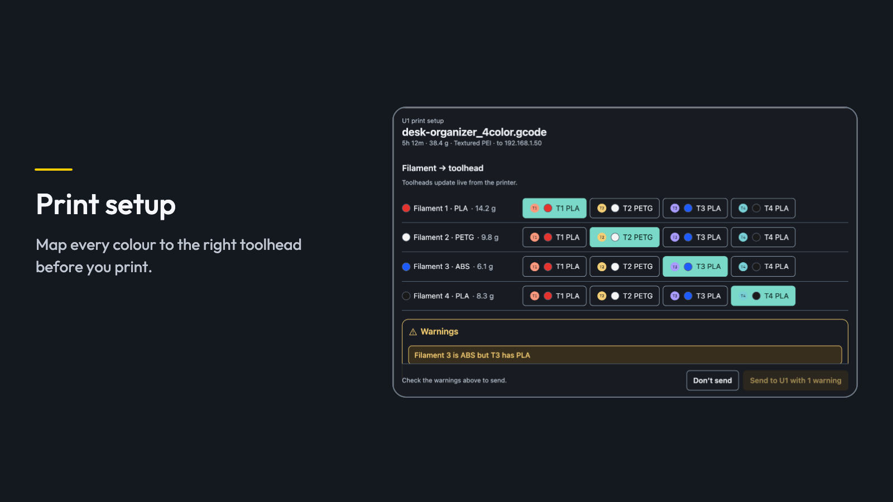
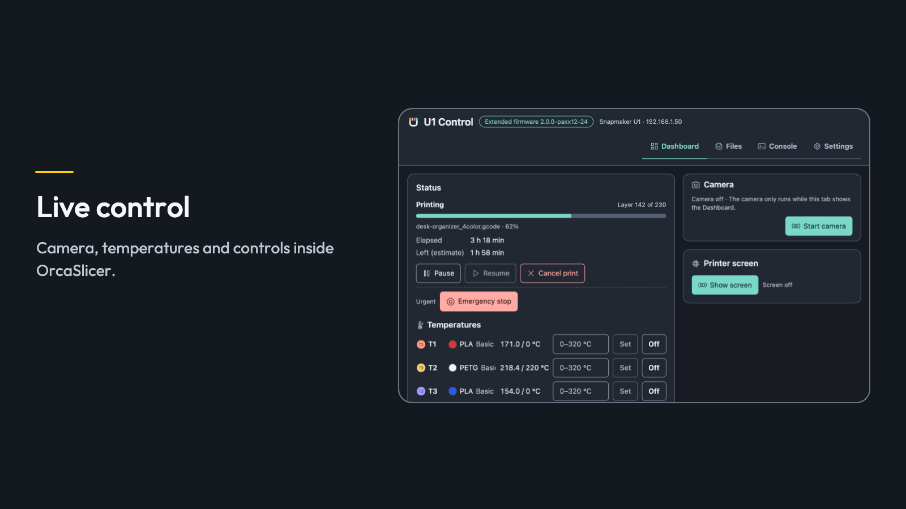
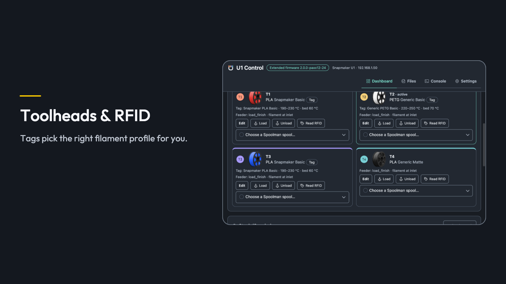
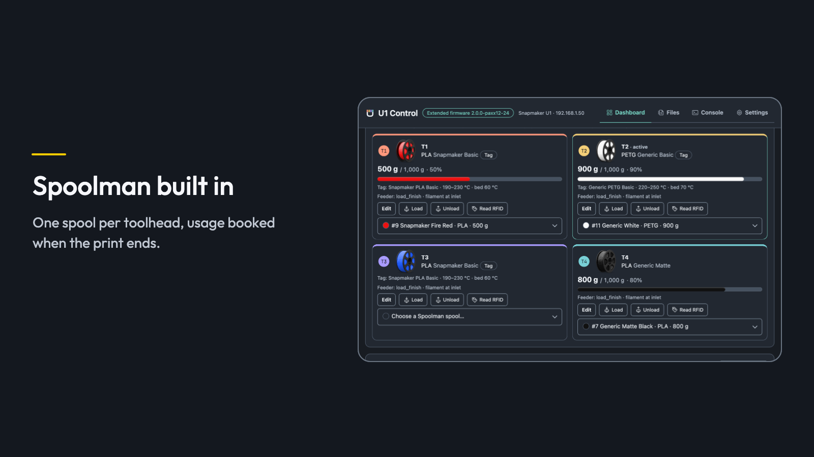
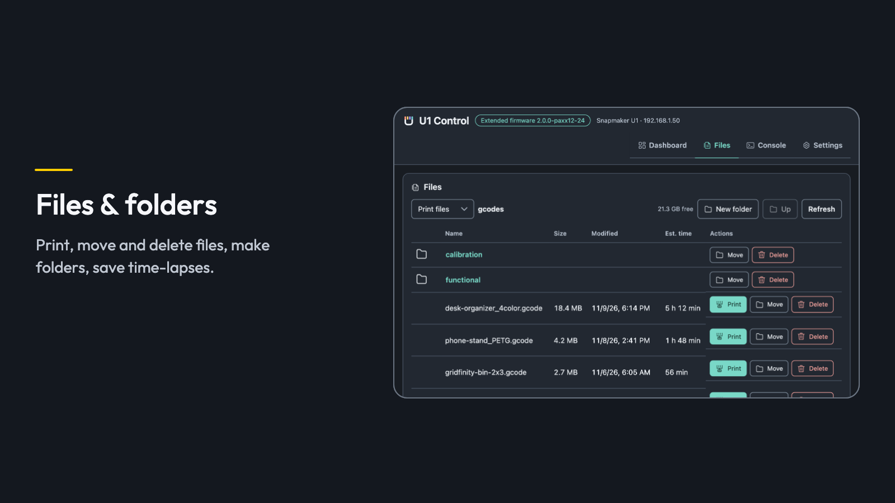

# Snapmaker U1 control for OrcaSlicer

{align=center}

u1control brings the U1 parts of Snapmaker Orca to the regular OrcaSlicer and adds a printer tab in
OrcaSlicer's own colours: a dashboard with camera, status, toolheads, RFID and Spoolman, a file
manager, and settings for calibration and the Extended Firmware. It works with the stock Snapmaker
firmware and with the U1 Extended Firmware. Local network only, no cloud.

## Print setup

{align=center}

When you press **Print**, each filament is matched to a toolhead by material and colour, with warnings
for empty heads or other materials. Auto bed leveling, flow calibration, time-lapse and the top cover
are set the way Snapmaker Orca sets them. u1control also fixes the U1 G-code: whole-bed mesh,
print-by-object tool-change lift, real layer count, file colours.

## Dashboard

{align=center}

Camera, status, temperatures with each head's filament, pause, resume, cancel and emergency stop,
chamber light and top cover, inside OrcaSlicer. With the Extended Firmware the printer's touchscreen
is on the dashboard too, and you can tap it. Resume a print after a power cut.

## Toolheads and RFID

{align=center}

The four toolheads sit on the dashboard: see and edit the filament in each head, load and unload, and
read tags again. RFID tags (Snapmaker, and with the Extended Firmware OpenRFID, OpenSpool and NTAG)
pick the right filament profile for your project.

## Spoolman

{align=center}

One spool per toolhead, picked from a list that shows each spool's colour, brand, material and grams
left. Filament use is recorded for each head when the print ends. Works with the
[Spooler](https://github.com/bloodf/spooler) plugin, which turns your spools into OrcaSlicer filament
profiles.

## Files and folders

{align=center}

Browse, print and delete files, create folders and move files into them, and save time-lapses.
Calibration, print options and the Extended Firmware settings are under Settings.

## Automagic or Expert

Automagic does everything it can by itself and only asks when a decision is needed. Expert turns each
step into a setting.

## Install

1. Subscribe, then open **File > Plugins**, click **Refresh** and tick **Activate**. Allow the
   background thread.
2. Select your Snapmaker U1 printer and enter its IP address (Wi-Fi icon next to the printer).
3. Automagic adds **U1 print setup** to your U1 process preset; save the preset.
4. Open the **U1 Control** tab next to Prepare and Preview.

Requires OrcaSlicer 2.5.0 or newer. Independent project, not made or supported by Snapmaker.

Source, documentation and issues: [github.com/bloodf/u1control](https://github.com/bloodf/u1control)
· License: GPL-3.0-only

## More plugins for your OrcaSlicer workflow

- **[Organizer](https://cloud.orcaslicer.com/app/plugins/shared-plugins/5bae3da1-7fcc-4cbd-ae25-53678e392d54)**: Arrange objects by their real outline and fill a build plate with more copies.
- **[Orca Print Calculator](https://cloud.orcaslicer.com/app/plugins/shared-plugins/5f807b01-bfb8-4ad4-a77d-e85e337e4c7f)**: Price every build plate: Spoolman filament cost, energy, labor, fees and a suggested selling price.
- **[Spooler](https://cloud.orcaslicer.com/app/plugins/shared-plugins/5c523246-d53c-44bc-a129-fe2470da6368)**: Your Spoolman spools and filament presets in OrcaSlicer, with what is left on each spool.

Each plugin works on its own; installed together they share data where it helps (U1 Control shows Spooler's stock; the Print Calculator uses Spooler's Spoolman address and filament presets).
